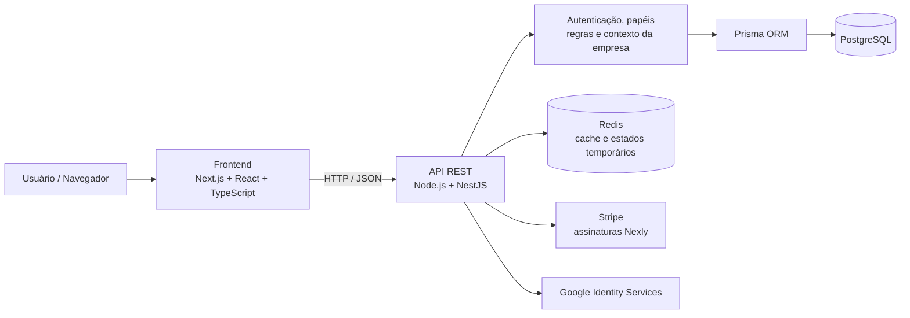
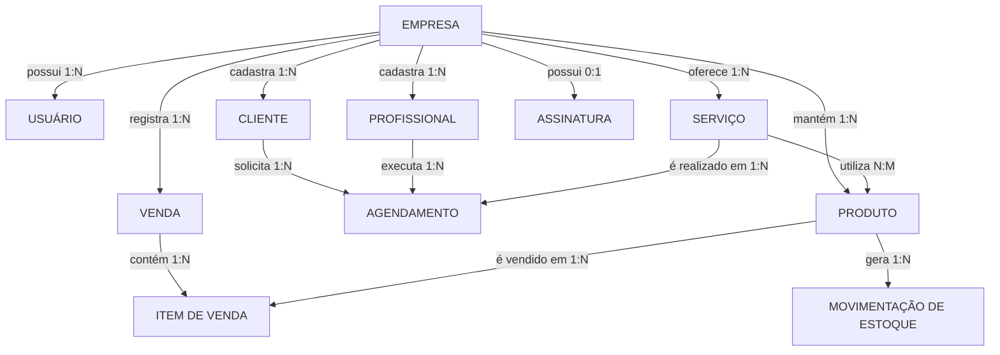
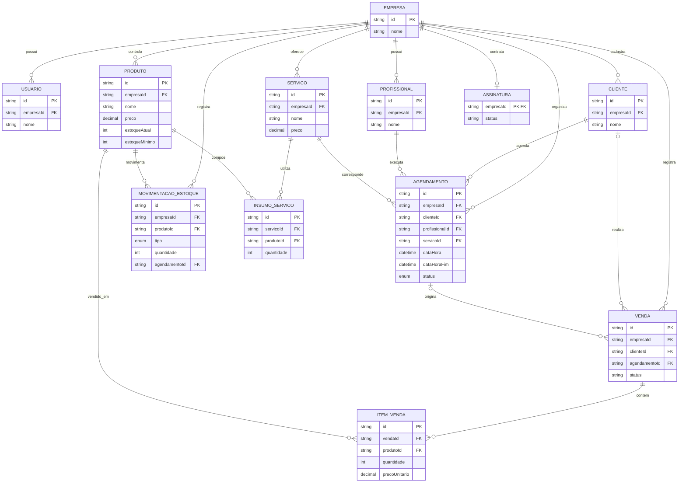

<div align="center">

<picture>
  <source media="(prefers-color-scheme: dark)" srcset="apps/web/public/logo.svg">
  
</picture>

# Nexly

### Gestão inteligente para pequenos negócios

**Agenda • Clientes • Serviços • Estoque • PDV • Relatórios**

[**Acessar a plataforma**](https://nexly-web.vercel.app) · [**Protótipo Figma**](https://www.figma.com/design/nZXYARpSTmoeK3Gg7P0apb/Nexly?node-id=0-1) · [**Documentação técnica**](docs/README.md)

     

**Projeto Integrador — Sprint 2 | 4º Termo | SENAI “A. Jacob Lafer” | Santo André, 2026**


</div>

> **Entrega de 23/10/2026:** desenvolvimento inicial e integração frontend/backend, persistência e CRUD, testes de software e documentação técnica ABNT. Este README é um guia técnico do repositório; a documentação acadêmica em Word/PDF é um entregável separado.

## Sumário

1. [Visão geral](#visão-geral)
2. [Objetivos e funcionalidades](#objetivos-e-funcionalidades)
3. [Sprint 2 — entregas e evidências](#sprint-2--entregas-e-evidências)
4. [Arquitetura e tecnologias](#arquitetura-e-tecnologias)
5. [Modelagem de dados: MER](#modelagem-de-dados-mer)
6. [Diagrama Entidade-Relacionamento: DER](#diagrama-entidade-relacionamento-der)
7. [API, rotas e operações CRUD](#api-rotas-e-operações-crud)
8. [Estrutura do repositório](#estrutura-do-repositório)
9. [Instalação e execução](#instalação-e-execução)
10. [Testes e validação](#testes-e-validação)
11. [Segurança e integrações](#segurança-e-integrações)
12. [Equipe e contribuições](#equipe-e-contribuições)
13. [Documentação e próximos passos](#documentação-e-próximos-passos)

---

## Visão geral

O **Nexly** é uma plataforma SaaS (**Software as a Service**) de gestão voltada a pequenos negócios — salões, barbearias, petshops, estúdios e estabelecimentos com atendimento por agendamento. Centraliza agenda, clientes, profissionais, serviços, estoque e vendas, evitando controles espalhados por diferentes ferramentas.

Seu diferencial é a **ligação entre serviços e insumos**: o estabelecimento define os produtos necessários a cada serviço, e o sistema relaciona a realização do atendimento com as movimentações de estoque. A arquitetura é **multiempresa (multi-tenant)**: cada negócio utiliza o mesmo sistema, mas as operações precisam respeitar o contexto e as permissões da empresa correspondente.

### Problema e solução

| Problema observado | Solução proposta |
|---|---|
| Agendamentos em uma ferramenta e clientes em outra | Agenda integrada aos cadastros |
| Consumo de material sem histórico confiável | Associação entre serviços, insumos e movimentações |
| Estoque e vendas controlados separadamente | Estoque e ponto de venda conectados |
| Dificuldade para acompanhar o negócio | Dashboard, indicadores e relatórios |
| Negócios com necessidades diferentes | Seleção de módulos e configurações por empresa |

## Objetivos e funcionalidades

O objetivo é desenvolver uma aplicação web responsiva para centralizar a operação comercial e os atendimentos de pequenos negócios, com persistência relacional e autorização baseada em papéis.

| Módulo | Funcionalidades documentadas |
|---|---|
| Autenticação | Cadastro, login, sessões, recuperação e opções de segundo fator |
| Painel | Indicadores, agenda do dia, avisos financeiros e de estoque |
| Agenda | Agendamentos, profissionais, serviços, horários e prevenção de conflitos |
| Clientes e equipe | Cadastros e gerenciamento conforme permissões |
| Serviços | Preços, duração e associação de insumos |
| Estoque | Produtos, saldo, movimentações e reposição |
| PDV e vendas | Registro de vendas, itens e histórico |
| Compras | Fornecedores, pedidos e recebimento |
| Financeiro | Lançamentos, baixas e relatórios operacionais |
| Assinaturas | Contratação e gerenciamento de planos do próprio Nexly por Stripe |

**Fluxo principal:** cadastrar empresa → cadastrar clientes/profissionais/serviços → configurar produtos e insumos → criar agendamento → concluir atendimento → registrar consumo → consultar vendas e indicadores.

## Sprint 2 — entregas e evidências

A Sprint 2 consolida a passagem do planejamento para a implementação integrada. As entregas registradas no projeto abrangem frontend, backend modular, banco relacional, configuração de ambiente, documentação e verificações automatizadas.

| Critério da atividade | Onde está demonstrado |
|---|---|
| Frontend atualizado | `apps/web/` — páginas, componentes, formulários e navegação responsiva |
| Backend atualizado | `apps/api/` — módulos, controllers, services e validações |
| Comunicação entre camadas | API REST do NestJS consumida pela aplicação Next.js |
| Persistência e CRUD | PostgreSQL com Prisma, schema e migrações |
| MER e DER | Diagramas conceitual e lógico resumidos nas próximas seções |
| Testes iniciais e regressões | Jest, Playwright, documentação de testes e workflows de CI |
| Documentação ABNT | Arquivos acadêmicos de documentação e plano de testes na pasta `docs/documentacao/` |
| Participação do grupo | Relatório da Sprint e histórico do GitHub |

> **Atenção sobre evidências:** os resultados citados abaixo são registros de execuções identificadas na documentação, não uma afirmação de que toda alteração futura passou nos mesmos testes. A validação final deve usar o commit e os workflows correspondentes à entrega.

### Progresso registrado

- Integração das funcionalidades de gestão e configuração de ambiente.
- Operações transacionais de estoque, pedidos e vendas com validações de consistência.
- Interface com formulários, respostas de erro, estados de carregamento e ajustes de acessibilidade.
- Autenticação, autorização por perfil e separação de dados por empresa.
- Integração de assinaturas e pagamento do **SaaS Nexly** com Stripe, sujeita à configuração do ambiente.

---

## Arquitetura e tecnologias



| Camada | Tecnologias | Finalidade |
|---|---|---|
| Frontend | Next.js 16, React 19, TypeScript, Tailwind CSS | Interface e navegação web |
| UX | Axios, React Hook Form, Zod, Recharts, Framer Motion, Sonner | Integração, formulários, gráficos, animações e alertas |
| Backend | Node.js 24, NestJS 12, Express | API REST e regras de negócio |
| Banco de dados | PostgreSQL 16 (ambiente local), Prisma 5 | Persistência e relacionamentos |
| Auxiliar | Redis 7 | Cache e estados temporários |
| Integrações | Google Identity Services, Stripe | Identidade e assinaturas |
| Qualidade | Jest, Playwright, ESLint, Prettier, GitHub Actions | Testes e automação |
| Ambiente | npm Workspaces, Turborepo, Docker Compose | Monorepo e serviços locais |

**Implantação documentada:** frontend associado à **Vercel**, backend ao **Railway** e PostgreSQL ao **Supabase**. A disponibilidade de cada serviço publicado deve ser conferida separadamente.

## Modelagem de dados: MER

O **Modelo Entidade-Relacionamento (MER)** representa o domínio do negócio de forma **conceitual**, sem priorizar nomes de colunas e detalhes de implementação. As cardinalidades mostram relações centrais do Nexly. Este é um *recorte acadêmico dos principais módulos*, não o catálogo completo dos 39 modelos Prisma.



**Regra conceitual importante:** a relação N:M entre **Serviço** e **Produto** é resolvida no modelo lógico por **InsumoServico**, que armazena a quantidade de material prevista por serviço. Uma venda pode ter cliente e agendamento opcionais. O vínculo entre os dados e a empresa é indispensável para o isolamento multiempresa.

## Diagrama Entidade-Relacionamento: DER

O **DER** abaixo detalha chaves primárias (**PK**), chaves estrangeiras (**FK**) e campos relevantes, baseados nos modelos do arquivo [`apps/api/prisma/schema.prisma`](apps/api/prisma/schema.prisma). Trata-se de um **DER lógico simplificado**; outras colunas, índices, enums e relacionamentos existem no schema completo.



> **Fonte da modelagem:** schema Prisma do repositório na branch `main`, consultado para esta elaboração. A representação omite propositalmente modelos complementares (ex.: fornecedores, pedidos, sessões, lançamentos financeiros, eventos Stripe e auditoria). Para obter o modelo completo e atualizado, consultar o Prisma e [`docs/MODELO_DADOS.md`](docs/MODELO_DADOS.md). O MER é conceitual; o DER é uma visão lógica parcial, portanto não substitui um diagrama físico integral.

### Regras de integridade e persistência

- **PK:** identifica unicamente um registro.
- **FK:** vincula registros relacionados e deve referenciar dados válidos.
- **Contexto da empresa:** várias entidades utilizam `empresaId`; tabelas filhas podem herdar o escopo por relações com o registro pai.
- **Transações:** operações compostas devem confirmar todas as alterações ou revertê-las em caso de falha.
- **Controle de estoque:** o consumo e as vendas requerem conferência de quantidades e histórico das movimentações.
- **Concorrência:** conflitos de agendamento, recebimento duplicado e edições simultâneas são tratados por regras de negócio e integridade.

---

## API, rotas e operações CRUD

A API NestJS organiza o processamento em **controllers**, **services** e **DTOs**. O frontend chama as rotas por HTTP e recebe dados JSON. O backend valida autenticação, permissões e contexto da empresa antes das operações protegidas.

### Exemplos de operações de negócio

| Recurso | Criar | Consultar | Atualizar | Excluir/desativar |
|---|---|---|---|---|
| Clientes | Cadastrar cliente | Listar e visualizar | Editar dados | Remover segundo regras e vínculos |
| Profissionais | Cadastrar profissional | Consultar equipe | Alterar perfil/disponibilidade | Desativar conforme regra |
| Serviços | Cadastrar serviço | Listar serviços | Atualizar preço/insumos | Remover ou desativar |
| Produtos | Cadastrar produto | Consultar estoque | Atualizar dados e estoque conforme operação | Remover conforme restrições |
| Agendamentos | Agendar atendimento | Consultar agenda | Reagendar, confirmar ou concluir | Cancelar |
| Vendas | Registrar venda | Consultar histórico | Alterações permitidas pelo fluxo | Cancelar conforme regra |

> **Nota:** a tabela descreve operações dos módulos, **não** inventa URLs HTTP específicas. Para métodos e endpoints exatos, consulte a [referência da API](docs/REFERENCIA_API.md), os controllers em `apps/api/src/` e o Swagger gerado localmente.

### Rotas confirmadas na documentação

| Método | Rota | Finalidade |
|---|---|---|
| `GET` | `/api/health/deep` | Verificação de integridade da API e dependências |
| `GET` | `/api/docs` | Interface Swagger em ambiente local configurado |
| `GET` | `/api/assinaturas` | Consultar disponibilidade e situação de assinatura |
| `POST` | `/api/assinaturas/checkout` | Iniciar contratação de plano |
| `POST` | `/api/assinaturas/portal` | Abrir portal da assinatura |
| `POST` | `/api/assinaturas/atualizar-status` | Atualizar estado consultando o provedor |
| `POST` | `/api/assinaturas/webhook` | Receber eventos Stripe com assinatura válida |

**Exemplo de comunicação:** usuário solicita uma agenda → frontend realiza requisição → API verifica sessão/perfil/empresa → service consulta ou altera o banco via Prisma → API responde em JSON → interface apresenta os dados ou uma mensagem de erro.

## Estrutura do repositório

```text
Nexly/
├── apps/
│   ├── web/                 # Next.js: páginas, componentes e interface
│   └── api/                 # NestJS: controllers, services, DTOs e Prisma
│       └── prisma/
│           └── schema.prisma # Modelos de dados e relacionamentos
├── packages/
│   ├── shared/              # Tipos, contratos e permissões compartilhados
│   └── tsconfig/            # Configurações TypeScript compartilhadas
├── docs/                    # Guias técnicos, testes e documentação
│   └── documentacao/        # Documentos acadêmicos, quando presentes
├── e2e/                     # Testes de ponta a ponta
├── .github/workflows/       # Integração contínua e verificações
├── docker-compose.yml       # Infraestrutura local
├── package.json             # Scripts do monorepo
└── README.md                # Apresentação e instruções
```

## Instalação e execução

### Pré-requisitos

- Git.
- Node.js compatível com `.nvmrc` (**mínimo exigido no `package.json`: 24.15.0**).
- npm compatível com o lockfile (o projeto declara npm 11.16.0).
- Docker e Docker Compose para subir PostgreSQL e Redis localmente.

### 1. Clonar e instalar

```bash
git clone https://github.com/Breno-J-Oliveira/Nexly.git
cd Nexly
npm ci
```

### 2. Preparar os serviços

```bash
docker compose up -d postgres redis
```

Crie as configurações locais copiando **somente os exemplos existentes**: `.env.example` para `.env`, `apps/api/.env.example` para `apps/api/.env` e `apps/web/.env.example` para `apps/web/.env`. Ajuste conexões e segredos próprios. **Não publique arquivos `.env`, credenciais ou dados reais no GitHub.**

### 3. Preparar o banco

```bash
npm run build --workspace @nexly/shared
npx prisma generate --schema apps/api/prisma/schema.prisma
npm run db:migrate --workspace @nexly/api
```

O seed é opcional e deve ser executado **apenas em banco local descartável** depois de conferir as instruções de desenvolvimento.

### 4. Iniciar a aplicação

```bash
npm run dev
```

| Serviço | Endereço local |
|---|---|
| Interface web | http://localhost:3002 |
| API — verificação profunda | http://localhost:3001/api/health/deep |
| Documentação interativa da API | http://localhost:3001/api/docs |

**Mais detalhes:** [`docs/DESENVOLVIMENTO.md`](docs/DESENVOLVIMENTO.md). A integração Stripe/Google e os provedores de comunicação podem exigir credenciais e ajustes adicionais; não são necessários para todas as funcionalidades locais.

## Testes e validação

A Sprint 2 exige evidências de testes, e não apenas o código das funcionalidades. O Nexly dispõe de testes de API, testes ponta a ponta e checks de qualidade.

### Comandos

```bash
npm run typecheck --workspace @nexly/api
npm run typecheck --workspace @nexly/web
npm run lint
npm test --workspace @nexly/api -- --runInBand
npm run e2e
```

> Testes de integração/E2E requerem banco, Redis e variáveis de ambiente preparados especificamente para testes. Os resultados mudam conforme o commit e o ambiente.

### Evidências registradas na documentação técnica

| Evidência histórica | Registro |
|---|---|
| API | Uma campanha de **40 suítes e 381 testes aprovados** |
| Regressão posterior | **2 suítes e 15 testes aprovados** |
| Navegador | Uma campanha com **42 testes aprovados** |
| Revisão de 23/10/2026 | E2E, testes da API e Semgrep registrados como aprovados para o commit `7b82af9`; uma verificação de audit das ferramentas permaneceu com falha |

Esses números representam **execuções diferentes**, não devem ser somados para anunciar um total global. Outros resultados e casos GOT constam da documentação complementar.

**Cenários prioritários:** cadastro e atualização, autenticação/autorização, agendamento sem conflitos, baixa de estoque, recebimento de pedidos, transação revertida após falha, isolamento de dados por empresa e jornada de usuário pelo navegador.

**Referências:** [`docs/TESTES.md`](docs/TESTES.md) · [GitHub Actions](https://github.com/Breno-J-Oliveira/Nexly/actions) · [Plano de testes e GOT](docs/documentacao/Nexly_Plano_de_Testes_e_GOT_ABNT.docx).

## Segurança e integrações

O Nexly documenta senhas com **Argon2id**, tokens **JWT RS256**, renovação de sessões, segundo fator TOTP, autorização por função, validação de entradas, registro de auditoria e isolamento por empresa. Esses controles ajudam a reduzir riscos, mas **não constituem certificação de segurança nem dispensam testes contínuos**.

**Pagamentos:** o Stripe processa **assinaturas da plataforma Nexly**. O PDV registra vendas dos estabelecimentos, mas isso não equivale a processar ou transferir pagamentos para cada empresa. O acesso ao plano pago depende de confirmação do estado da assinatura e das condições de pagamento, não apenas do retorno visual do checkout.

**Limitações atuais documentadas:** envio de e-mails exige provedor e remetente configurados; restauração externa de backups precisa de verificação operacional; algumas rotinas financeiras e a homologação comercial de integrações ainda requerem evolução.

Consulte [`docs/SEGURANCA.md`](docs/SEGURANCA.md), [`docs/PAGAMENTOS.md`](docs/PAGAMENTOS.md) e [`docs/OPERACAO.md`](docs/OPERACAO.md).

## Equipe e contribuições

Projeto desenvolvido pela **NexusTech**, no curso **Técnico em Desenvolvimento de Sistemas** da **Escola SENAI “A. Jacob Lafer”**, em Santo André — SP (2026).

| Integrante | Contribuição registrada no relatório da sprint |
|---|---|
| **Breno Oliveira** | Conclusão do site e apoio na prototipação no Figma |
| **Felipe Bertaco Cruz** | Conclusão das tarefas atribuídas |
| **Gustavo Barreto** | Contribuição destacada no Figma e conclusão das atividades |
| **Mariana Felipe / Mariana Nascimento** | Conclusão das atividades dentro do prazo; o relatório e a documentação apresentam formas diferentes do nome, a confirmar na entrega |
| **Nicolas Tukaze Onda** | Conclusão das tarefas atribuídas; consta no relatório da sprint, mas não na lista de autores da documentação atual |
| **Vinícius Vila Nova** | 5W2H, cronograma, organização do grupo, slides e relatório da sprint |

**Orientadores:** Prof. Raul Lopes e Prof. Paulo Camargo.

> **Conferência obrigatória antes do envio:** o relatório inclui **Nicolas**, enquanto a capa da documentação acadêmica lista **cinco autores** sem ele. Confirme com o PO a relação oficial dos integrantes para que README, capa ABNT e comentário de entrega tenham os mesmos nomes. A divergência foi preservada, e não resolvida por suposição.

### Histórico de desenvolvimento

O histórico de contribuições e a participação técnica podem ser acompanhados em [**Commits**](https://github.com/Breno-J-Oliveira/Nexly/commits/main/), [**Contributors**](https://github.com/Breno-J-Oliveira/Nexly/graphs/contributors) e [**Actions**](https://github.com/Breno-J-Oliveira/Nexly/actions). O relatório da sprint é complementar ao histórico do Git; atividades de design e planejamento nem sempre correspondem diretamente a commits.

## Documentação e próximos passos

| Material | Conteúdo |
|---|---|
| [`docs/README.md`](docs/README.md) | Índice da documentação técnica |
| [`docs/PRODUTO.md`](docs/PRODUTO.md) | Problema, produto, requisitos e funcionalidades |
| [`docs/ARQUITETURA.md`](docs/ARQUITETURA.md) | Organização, tecnologias e integração |
| [`docs/REFERENCIA_API.md`](docs/REFERENCIA_API.md) | Endpoints e referência das rotas reais |
| [`docs/MODELO_DADOS.md`](docs/MODELO_DADOS.md) | Esquema e relacionamentos de dados |
| [`docs/TESTES.md`](docs/TESTES.md) | Testes, resultados e evidências |
| [`docs/HISTORICO.md`](docs/HISTORICO.md) | Evolução e alterações registradas |
| [`docs/documentacao/Nexly_Documentacao_Completa_ABNT.docx`](docs/documentacao/Nexly_Documentacao_Completa_ABNT.docx) | Documentação acadêmica; verificar arquivo no repositório |
| [`docs/documentacao/Nexly_Plano_de_Testes_e_GOT_ABNT.docx`](docs/documentacao/Nexly_Plano_de_Testes_e_GOT_ABNT.docx) | Plano de testes e GOT; verificar arquivo no repositório |

### Checklist de envio — Sprint 2

- [x] README com visão geral, stack, arquitetura, MER/DER, execução e testes.
- [x] Localização do frontend, backend, banco e módulos de CRUD.
- [x] Referências ao histórico de commits e ao relatório de contribuições.
- [ ] Conferir integrantes oficiais entre relatório, README e documento ABNT.
- [ ] Garantir que o PDF/Word final tenha capa, folha de rosto, sumário, diagramas, codificação e evidências.
- [ ] Anexar a documentação técnica no envio da atividade.
- [ ] PO informar todos os integrantes e o link do repositório no comentário da entrega.
- [ ] Conferir o último workflow no commit efetivamente enviado.

**Próximos passos técnicos:** revisar UI/UX e acessibilidade, ampliar testes de regressão e segurança, homologar integrações, verificar backups/restauração, revisar configurações de deploy e preparar condições de uso real.

---

<div align="center">

**Nexly — uma gestão mais conectada, do agendamento ao resultado.**

[Repositório GitHub](https://github.com/Breno-J-Oliveira/Nexly) · [Plataforma](https://nexly-web.vercel.app) · [Contato](mailto:breno.emailsenai@gmail.com)

Desenvolvido pela **NexusTech** · SENAI “A. Jacob Lafer” · 2026

</div>
