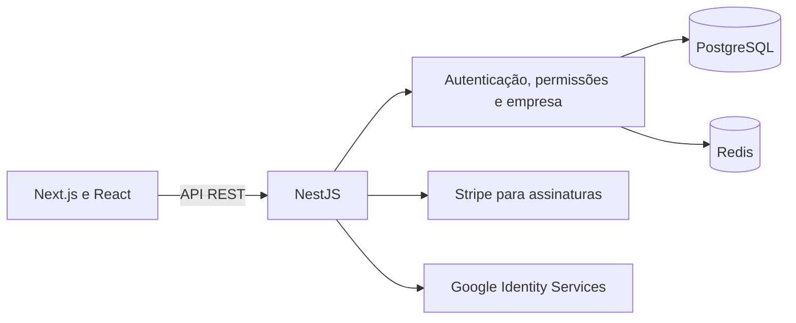

# Nexly — Gestão inteligente para pequenos negócios

<p align="center">
  <picture>
    <source media="(prefers-color-scheme: dark)" srcset="apps/web/public/logo.svg">
    
  </picture>
</p>

<p align="center">Agenda, clientes, estoque e vendas conectados à rotina de quem atende.</p>

<p align="center">
  <a href="https://nexly-web.vercel.app">Conhecer o Nexly</a> ·
  <a href="docs/README.md">Documentação</a> ·
  <a href="https://www.figma.com/design/nZXYARpSTmoeK3Gg7P0apb/Nexly?node-id=0-1">Protótipo no Figma</a>
</p>

<p align="center">
  
  
  
  
  
  
  
  
  <br>
  <a href="https://github.com/Breno-J-Oliveira/Nexly/actions/workflows/ci.yml"></a>
  <a href="https://github.com/Breno-J-Oliveira/Nexly/actions/workflows/security.yml"></a>
</p>

<p align="center">
  
</p>

## Equipe do projeto

Desenvolvido pela **NexusTech**, no curso **Técnico em Desenvolvimento de Sistemas da Escola SENAI “A. Jacob Lafer”**, Santo André, 2026.

| Integrantes            |
| ---------------------- |
| **Breno Oliveira**     |
| **Felipe Bertaco**     |
| **Gustavo Barreto**    |
| **Mariana Nascimento** |
| **Vinícius Vila Nova** |

**Orientadores:** Prof. Raul Lopes e Prof. Paulo Camargo.

**Breno J. Oliveira:** [GitHub](https://github.com/Breno-J-Oliveira) · [LinkedIn](https://www.linkedin.com/in/breno-j-oliveira-672619352/) · [Instagram](https://www.instagram.com/brenoov) · [X](https://x.com/BrenoJOliveira_)

**Suporte e contato do Nexly:** [breno.emailsenai@gmail.com](mailto:breno.emailsenai@gmail.com)

**Documentos completos:** [Documentação técnica e funcional em Word](docs/documentacao/Nexly_Documentacao_Completa_ABNT.docx) · [Plano de testes e GOT em Word](docs/documentacao/Nexly_Plano_de_Testes_e_GOT_ABNT.docx)

## O que é o Nexly?

O **Nexly** é uma plataforma SaaS de gestão para pequenos negócios, como salões, barbearias, clínicas, petshops e estúdios. Reúne os dados do atendimento e da operação para reduzir o trabalho de conferir agendas, planilhas e controles separados.

Seu diferencial é a **agenda conectada ao estoque**: cada serviço pode ter materiais e quantidades configurados. Ao concluir o atendimento, o sistema registra o consumo desses insumos, mantendo o histórico da operação.

O projeto foi desenvolvido como Trabalho de Conclusão de Curso de Desenvolvimento de Sistemas no SENAI. A aplicação utiliza uma arquitetura multiempresa: os negócios compartilham a plataforma, com contexto e controles de acesso para separar seus registros.

## O que ele entrega?

### Para quem administra o negócio

- **Painel geral** com indicadores, agenda do dia e alertas de estoque, contas e confirmações.
- **Agenda e cadastros** de clientes, profissionais e serviços, com controle de disponibilidade e conflitos.
- **Estoque e PDV** com produtos, movimentos, consumo de insumos e histórico de vendas.
- **Financeiro e relatórios** para acompanhar vencimentos, receitas, despesas e resultados da operação.
- **Compras, fornecedores e comissões** integrados às rotinas do negócio.
- **Tarefas, filiais, documentos, recorrências e automações** para organizar o trabalho da equipe.
- **Presets e módulos configuráveis** para montar uma experiência adequada ao segmento.

### Para a equipe e os clientes

- Acesso por função, com permissões aplicadas na API.
- Agendamento público e confirmação conforme disponibilidade.
- Histórico de relacionamento, fidelidade e preparação de campanhas.
- Login por senha ou Google configurado, segundo fator e gerenciamento de sessões.
- Interface responsiva, navegação por teclado e recuperação de erros nas telas revisadas.

### Para quem desenvolve e mantém

- Monorepo com Next.js, NestJS e contratos compartilhados em TypeScript.
- Prisma, migrações, PostgreSQL e contexto de empresa nas operações de negócio.
- Redis para cache, cotas distribuídas e estados temporários.
- Regras transacionais e processamento persistido para operações que precisam de consistência.
- Integração Stripe para assinaturas do Nexly, com separação entre teste e produção.
- Jest, Playwright, Docker e verificações automatizadas no GitHub Actions.

Consulte o [guia do produto](docs/PRODUTO.md) para regras e limites. E-mail e WhatsApp automáticos dependem de configuração de provedor; uma integração implementada não significa envio ativo no ambiente publicado.

## Como funciona na prática?

1. A empresa escolhe seu segmento e os módulos no cadastro.
2. Cadastra profissionais, clientes, serviços e produtos.
3. Define quais materiais cada serviço consome.
4. Marca e realiza o atendimento.
5. Ao concluir, acompanha a baixa dos insumos e o histórico.
6. Consulta agenda, vendas, pendências e indicadores no mesmo sistema.

## Assinaturas e pagamentos

O Stripe cobra as assinaturas do próprio Nexly. Isso é diferente de registrar as vendas dos estabelecimentos no PDV: a integração atual não transfere esses valores aos negócios nem utiliza divisão de pagamentos de marketplace.

| Plano        | Código     | Mensalidade | Profissionais ativos                  |
| ------------ | ---------- | ----------- | ------------------------------------- |
| Gratuito     | FREE       | R$ 0        | 1                                     |
| Essencial    | BASIC      | R$ 49       | 2                                     |
| Profissional | PRO        | R$ 99       | 10                                    |
| Empresarial  | ENTERPRISE | R$ 199      | Sem limite comercial de profissionais |

### Como a contratação funciona

1. O administrador autenticado escolhe um plano aprovado.
2. O backend confere preço, moeda BRL, recorrência mensal e ambiente no Stripe.
3. Uma sessão do Checkout hospedado pelo Stripe recebe os dados de pagamento.
4. O webhook assinado ou a atualização autenticada consulta o estado atual da assinatura.
5. O plano de produção é atualizado somente quando as condições pagas são confirmadas.

O retorno de sucesso não libera acesso por conta própria. A regra exige assinatura ativa, fatura paga, período vigente e ausência de pausa de cobrança. Travas transacionais, idempotência e registro de eventos protegem repetições e concorrência. Uma simulação no ambiente test não concede um plano comercial live.

### Trocas, cancelamentos e recebimento

O Customer Portal permite gerenciar a assinatura conforme as opções habilitadas na conta Stripe. Proporcionalidade, troca de plano, forma de pagamento e cancelamento precisam ser homologados nessa configuração. Cancelamento agendado preserva o período pago enquanto as condições continuam válidas.

O recebimento pelo responsável depende da ativação e verificação da conta Stripe, dos dados bancários e do saldo disponível. Pagamento aprovado e depósito bancário são etapas diferentes. Os prazos e taxas aplicáveis são consultados no provedor. O catálogo atual é mensal; não configura anuidade, cupom, período de teste gratuito ou cálculo automático de impostos.

O [guia completo de pagamentos](docs/PAGAMENTOS.md) descreve estados, eventos, variáveis, endpoints, permissões, recebimento e diagnóstico. O acompanhamento de webhooks é necessário: este módulo não agenda reconciliação periódica de todas as assinaturas.

## Arquitetura



O frontend é publicado na Vercel, a API foi configurada no Railway e o PostgreSQL é hospedado no Supabase. Redis é complementar ao banco principal. A arquitetura e o papel de cada tecnologia estão explicados em [Arquitetura](docs/ARQUITETURA.md), inclusive para quem está começando em programação.

## Proteções implementadas

| Área            | Controles do projeto                                                                   |
| --------------- | -------------------------------------------------------------------------------------- |
| Conta           | Hash de senha Argon2id, JWT RS256, sessões e rotação de refresh token.                 |
| Segundo fator   | TOTP, códigos de recuperação e proteção contra repetição nos fluxos cobertos.          |
| Empresas        | Escopo na aplicação, validação de vínculos e políticas de acesso no PostgreSQL.        |
| Permissões      | Regras compartilhadas por função, com autorização efetiva no backend.                  |
| API e navegador | Validação de entradas, limites distribuídos, CORS e cabeçalhos de segurança.           |
| Auditoria       | Registro de ações e alterações, com redação de campos sensíveis.                       |
| Assinaturas     | Webhook assinado, separação de ambientes, idempotência e reconciliação do estado.      |
| Operação        | Scripts de backup cifrado e restauração de teste, dependentes de configuração externa. |

Esses controles exigem configuração e revisão contínua. O projeto não declara segurança absoluta nem certificação legal. Veja [Segurança](docs/SEGURANCA.md) e [Operação](docs/OPERACAO.md) para limites, incidentes e cuidados com credenciais.

## Stack tecnológica

| Camada       | Tecnologias                                                             |
| ------------ | ----------------------------------------------------------------------- |
| Interface    | Next.js 16, React 19, TypeScript e Tailwind CSS 3.                      |
| Experiência  | Inter, Font Awesome, Framer Motion, Recharts e Sonner.                  |
| Formulários  | React Hook Form, Zod e Axios.                                           |
| Backend      | Node.js 24, NestJS 12, Express e validação por DTOs.                    |
| Persistência | Prisma 5, PostgreSQL 16 e Redis 7.                                      |
| Integrações  | Google Identity Services, Stripe e provedores opcionais de comunicação. |
| Qualidade    | Jest, Playwright, ESLint, Prettier e GitHub Actions.                    |
| Ambiente     | npm workspaces, Turborepo e Docker Compose.                             |

Versões exatas estão no lockfile. O catálogo completo de bibliotecas e suas finalidades está em [Arquitetura](docs/ARQUITETURA.md).

## Executar localmente

Use Node.js da versão indicada em `.nvmrc` e Docker Compose para PostgreSQL e Redis. A partir da raiz:

```bash
npm ci
docker compose up -d postgres redis
```

Copie `.env.example`, `apps/api/.env.example` e `apps/web/.env.example` para os respectivos arquivos `.env`, somente se ainda não existirem. Ajuste as conexões locais e mantenha integrações externas desativadas até configurá-las.

```bash
npm run build --workspace @nexly/shared
npx prisma generate --schema apps/api/prisma/schema.prisma
npm run db:migrate --workspace @nexly/api
npm run dev
```

- **Aplicação:** <http://localhost:3002>
- **Saúde da API:** <http://localhost:3001/api/health/deep>
- **Swagger local:** <http://localhost:3001/api/docs>

O seed é opcional e destinado somente a banco local descartável. O [guia de desenvolvimento](docs/DESENVOLVIMENTO.md) explica configuração, conta demonstrativa, portas, migrações, comandos e execução no Windows.

## Testes e qualidade

```bash
npm run typecheck --workspace @nexly/api
npm run typecheck --workspace @nexly/web
npm run lint
npm test --workspace @nexly/api -- --runInBand
npm run e2e
```

Testes integrados precisam de banco e Redis de teste preparados. O [plano de testes](docs/TESTES.md) descreve os cenários, critérios e limites das evidências. Os badges exibem o estado dos workflows; não há contador estático de testes apresentados como permanentemente aprovados.

## Documentação

| Documento                                  | Conteúdo                                       |
| ------------------------------------------ | ---------------------------------------------- |
| [Índice](docs/README.md)                   | Caminhos de leitura e documentos acadêmicos.   |
| [Produto](docs/PRODUTO.md)                 | Módulos, jornadas, planos e identidade visual. |
| [Arquitetura](docs/ARQUITETURA.md)         | Tecnologias, comunicação e decisões técnicas.  |
| [Desenvolvimento](docs/DESENVOLVIMENTO.md) | Instalação, comandos e ambiente local.         |
| [API](docs/REFERENCIA_API.md)              | Rotas extraídas dos controllers.               |
| [Banco](docs/MODELO_DADOS.md)              | Modelos e relações do schema Prisma.           |
| [Segurança](docs/SEGURANCA.md)             | Identidade, permissões, isolamento e limites.  |
| [Operação](docs/OPERACAO.md)               | Publicação, integrações, backup e incidentes.  |
| [Testes](docs/TESTES.md)                   | Matriz GOT, evidências e critérios de aceite.  |
| [Histórico](docs/HISTORICO.md)             | Entregas recentes documentadas.                |

## Autoria, contatos e uso

Trabalho acadêmico de **Breno Oliveira, Felipe Bertaco, Gustavo Barreto, Mariana Nascimento e Vinícius Vila Nova**, da Escola SENAI “A. Jacob Lafer”. O protótipo visual contou com a participação de Breno Oliveira, Felipe Bertaco e Gustavo Barreto.

- Desenvolvimento e repositório: [Breno J. Oliveira](https://github.com/Breno-J-Oliveira).
- Suporte do Nexly: **breno.emailsenai@gmail.com**.

Não há arquivo `LICENSE` neste repositório nesta revisão. Para reutilização e redistribuição, consulte os responsáveis pelo projeto; não se presume uma licença de código aberto.
