<a id="topo"></a>

<div align="center">

<picture>
  <source media="(prefers-color-scheme: dark)" srcset="apps/web/public/logo.svg">
  
</picture>

# Nexly

### Gestão conectada para pequenos negócios

**Agenda, clientes, serviços, estoque, vendas e financeiro em uma única plataforma.**

Um SaaS multiempresa para organizar o atendimento e acompanhar o negócio — do primeiro agendamento ao consumo de materiais e ao registro da venda.

<p>
  <a href="https://nexly-web.vercel.app"></a>
  <a href="#documentacao"></a>
  <a href="https://www.figma.com/design/nZXYARpSTmoeK3Gg7P0apb/Nexly?node-id=0-1"></a>
  <a href="https://app.clickup.com/1600370000006731/v/f/1600370000039761/1600370000035041"></a>
  <a href="#instalacao"></a>
</p>

<p>
  
  
  
  
  
  
  
</p>

<p>
  <a href="https://github.com/Breno-J-Oliveira/Nexly/actions/workflows/ci.yml"></a>
  
  
  
</p>

<a href="docs/Screenshots/nexly-painel_geral.png">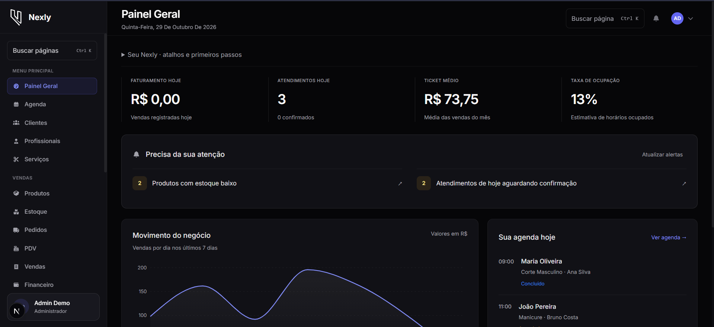</a>

<sub>Aplicação atual com dados de demonstração. Valores ilustrativos não representam resultados de clientes.</sub>

**NexusTech · Técnico em Desenvolvimento de Sistemas · SENAI “A. Jacob Lafer” · 2026**

</div>

---

## Navegação

| Conhecer o produto                     | Explorar a implementação                | Executar e acompanhar                    |
| -------------------------------------- | --------------------------------------- | ---------------------------------------- |
| [Visão geral](#visao-geral)            | [Arquitetura](#arquitetura)             | [Instalação local](#instalacao)          |
| [Jornadas de uso](#jornadas)           | [Stack tecnológica](#stack)             | [Variáveis de ambiente](#ambiente)       |
| [Funcionalidades](#funcionalidades)    | [Banco, MER e DER](#dados)              | [Comandos úteis](#comandos)              |
| [Tour visual e galeria](#galeria)      | [API REST](#api)                        | [Testes e evidências](#testes)           |
| [Site e páginas públicas](#site)       | [Autenticação e permissões](#acesso)    | [CI, publicação e operação](#operacao)   |
| [Figma e identidade visual](#figma)    | [Segurança e privacidade](#seguranca)   | [Diagnóstico de problemas](#diagnostico) |
| [Planos e assinaturas](#planos)        | [Integrações e NexusAuth](#integracoes) | [Documentação](#documentacao)            |
| [Equipe e contexto acadêmico](#equipe) | [Estrutura do repositório](#estrutura)  | [Roadmap e contribuições](#roadmap)      |

**Primeira visita?** Comece pela visão geral e pelo tour visual. **Vai desenvolver?** Leia arquitetura, instalação e API. **Vai avaliar a entrega?** Consulte os documentos acadêmicos e as evidências.

---

<a id="visao-geral"></a>

## 1. Visão geral

O **Nexly** é uma aplicação web de gestão para pequenos negócios que trabalham com atendimentos, serviços e venda de produtos. Reúne informações que normalmente ficam separadas em agendas, planilhas e anotações: clientes, profissionais, horários, estoque, vendas e contas.

**SaaS** significa que o produto é oferecido como um serviço acessado pelo navegador. **Multiempresa**, ou _multi-tenant_, significa que várias empresas utilizam a mesma aplicação, com seus registros e acessos delimitados pelo contexto de cada negócio.

### Para quem foi pensado

| Segmento                               | Exemplos de uso                                          |
| -------------------------------------- | -------------------------------------------------------- |
| Salões de beleza                       | Profissionais, serviços, horários e consumo de produtos. |
| Barbearias                             | Agenda, venda de produtos e consulta de comissões.       |
| Petshops                               | Relacionamento com clientes, atendimentos e produtos.    |
| Estúdios e profissionais autônomos     | Contatos e rotina de atendimento centralizados.          |
| Negócios de estética e outros serviços | Seleção de módulos e linguagem conforme a operação.      |

Os segmentos orientam a configuração inicial. Escolher um preset não transforma o Nexly em prontuário clínico, sistema fiscal ou solução especializada para uma atividade regulada.

### Qual problema ele resolve

| Na rotina do negócio                      | No Nexly                                       |
| ----------------------------------------- | ---------------------------------------------- |
| Horários e contatos espalhados            | Agenda integrada aos cadastros.                |
| Material consumido sem histórico          | Serviços associados a insumos e movimentações. |
| Estoque desconectado das vendas           | PDV, produtos e saldo relacionados pela API.   |
| Dificuldade para acompanhar pendências    | Indicadores e alertas do negócio.              |
| Funções que a empresa não utiliza         | Escolha de módulos e personalização inicial.   |
| Acessos sem distinção de responsabilidade | Perfis e permissões verificados no backend.    |

### O que cada público encontra

- **Administração:** indicadores, agenda, estoque, vendas, contas e configuração da empresa.
- **Equipe:** recursos de atendimento e caixa liberados conforme o papel e os módulos.
- **Clientes do estabelecimento:** agendamento público quando configurado.
- **Desenvolvimento:** monorepositório TypeScript, API NestJS, schema Prisma, migrações e testes.

[Voltar ao topo](#topo)

---

<a id="jornadas"></a>

## 2. Diferencial e jornadas de uso

### Do atendimento ao estoque

O diferencial central é a ligação entre **serviços e insumos**. Um serviço pode consumir quantidades definidas de um ou mais produtos. Ao concluir o atendimento, o sistema processa esse consumo e mantém o histórico correspondente.

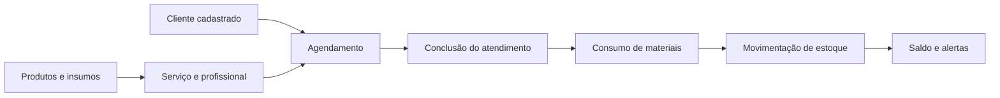

**Exemplo:** um serviço de coloração utiliza uma unidade de tinta cadastrada como insumo. Depois de concluir o agendamento, a saída é registrada no estoque. Repetir uma solicitação não deve consumir novamente o mesmo material. Uma falta prevista pode gerar pendência de consumo; erros internos inesperados devem reverter a transação.

| Jornada              | Passos                                                                               | Resultado que pode ser conferido                           |
| -------------------- | ------------------------------------------------------------------------------------ | ---------------------------------------------------------- |
| Primeiro atendimento | Configurar negócio → cadastrar cliente, profissional e serviço → agendar → concluir. | Atendimento registrado e consumo dos insumos configurados. |
| Venda no balcão      | Cadastrar produto → montar carrinho → informar cliente e pagamento → finalizar.      | Venda, itens e movimentação de estoque persistidos.        |
| Reposição            | Cadastrar fornecedor → criar pedido → enviar → receber.                              | Estado do pedido e entrada dos produtos.                   |

O PDV registra a forma de pagamento informada. Esse registro não realiza, por si só, uma transferência Pix nem uma cobrança em uma adquirente.

[Voltar ao topo](#topo)

---

<a id="funcionalidades"></a>

## 3. Funcionalidades

As áreas abaixo têm implementação no repositório. O acesso depende das permissões, da configuração da empresa e, quando aplicável, de integrações externas.

### Atendimento e relacionamento

| Área                   | O que oferece                                                                 |
| ---------------------- | ----------------------------------------------------------------------------- |
| **Painel geral**       | Indicadores, agenda do dia, estoque e pendências financeiras conforme acesso. |
| **Agenda**             | Criação, confirmação, conclusão, cancelamento, disponibilidade e conflitos.   |
| **Clientes**           | Contatos, busca, observações, métricas e histórico.                           |
| **Profissionais**      | Equipe, especialidades, disponibilidade e limites ativos por plano.           |
| **Serviços**           | Preço, duração e associação de insumos.                                       |
| **Agendamento online** | Link público por empresa, serviços e horários disponíveis.                    |
| **Fidelidade**         | Pontos, ranking e acompanhamento do relacionamento.                           |
| **Comissões**          | Valores e histórico de cálculo; o repasse ao profissional é externo.          |

### Vendas, estoque e financeiro

| Área                       | O que oferece                                                    |
| -------------------------- | ---------------------------------------------------------------- |
| **Produtos**               | Cadastro, SKU, categoria, preço e informações de estoque.        |
| **Estoque**                | Entradas, saídas, reposição, validade e pendências de consumo.   |
| **PDV**                    | Carrinho, cliente, desconto, pagamento e finalização.            |
| **Vendas**                 | Histórico, itens, filtros e estorno conforme regras e permissão. |
| **Fornecedores e compras** | Fornecedores, pedidos, rascunhos e recebimento.                  |
| **Financeiro**             | Receitas, despesas, vencimentos, baixas e pagamentos parciais.   |
| **Estoque por unidade**    | Saldos e transferências entre a central e as filiais.            |
| **Relatórios**             | Vendas, caixa, agenda, profissionais e materiais.                |
| **Cupons**                 | Condições de desconto nos fluxos permitidos.                     |

### Gestão e operação

| Área                          | O que oferece                                                                      |
| ----------------------------- | ---------------------------------------------------------------------------------- |
| **Filiais**                   | Unidades e associação das operações correspondentes.                               |
| **Tarefas**                   | Prioridade, responsável, prazo e unidade.                                          |
| **Recorrências**              | Séries de atendimentos e ocorrências futuras.                                      |
| **Automação**                 | Geração de tarefas recorrentes com controle de duplicidade.                        |
| **Documentos**                | Conteúdo operacional, versões e impressão/PDF; sem assinatura digital incorporada. |
| **Marketing**                 | Campanhas e contatos autorizados para abordagem manual por WhatsApp.               |
| **Importação**                | Preparação e conferência de CSV nos fluxos disponíveis.                            |
| **Histórico de alterações**   | Eventos de auditoria conforme permissão.                                           |
| **Saúde e rotinas**           | Dependências, trabalhos e registros de verificação.                                |
| **Usuários e conta**          | Equipe, convites, sessões, senha, segundo fator e Google configurável.             |
| **Meu Nexly e configurações** | Módulos, preset, perfil, horários e notificações.                                  |

As dependências entre módulos são consideradas na configuração. A agenda, por exemplo, utiliza clientes, profissionais e serviços. Referência: [`workspace.ts`](packages/shared/src/workspace.ts).

[Voltar ao topo](#topo)

---

<a id="galeria"></a>

## 4. Tour visual da aplicação

As imagens vieram das **32 capturas atuais fornecidas pelo autor**, em [`docs/Screenshots`](docs/Screenshots). O painel aparece na capa; as demais telas estão nas galerias abaixo. Clique em uma imagem para abrir o original.

Algumas capturas mostram listas vazias, valores estimados ou informações indisponíveis, conforme o estado fotografado. São exemplos da interface com massa de demonstração, não provas de resultados de clientes.

### Agenda e ponto de venda

<a href="docs/Screenshots/nexly-agenda.png"></a>

_Agenda: horários, profissionais e estados dos atendimentos em uma mesma tela._

<a href="docs/Screenshots/nexly-pdv.png"></a>

_PDV: escolha de produtos, montagem do carrinho e registro da venda._

<details>
<summary><strong>Atendimento, catálogo e operação · 8 telas</strong></summary>

<table>
<tr>
<td width="50%" valign="top"><h4>Agenda</h4>
<a href="docs/Screenshots/nexly-agenda.png">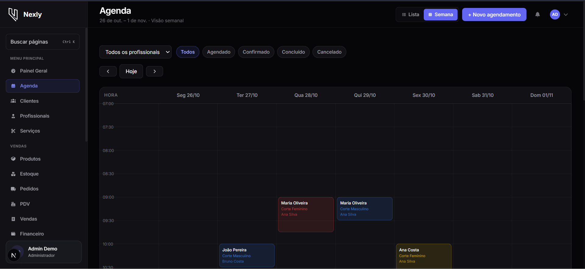</a>
</td>
<td width="50%" valign="top"><h4>Clientes</h4>
<a href="docs/Screenshots/nexly-clientes.png">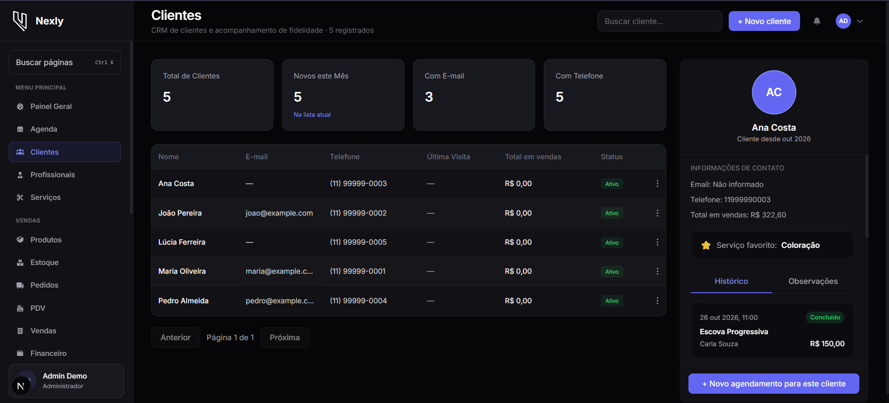</a>
</td>
</tr>
<tr>
<td width="50%" valign="top"><h4>Profissionais</h4>
<a href="docs/Screenshots/nexly-profissionais.png">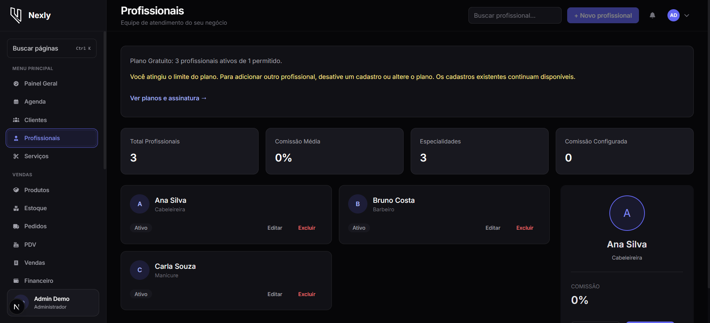</a>
</td>
<td width="50%" valign="top"><h4>Serviços</h4>
<a href="docs/Screenshots/nexly-servi%C3%A7os.png"></a>
</td>
</tr>
<tr>
<td width="50%" valign="top"><h4>Produtos</h4>
<a href="docs/Screenshots/nexly-produtos.png">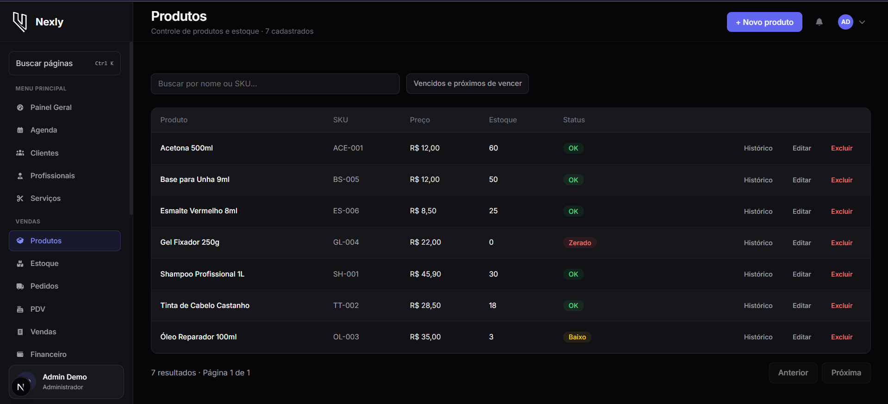</a>
</td>
<td width="50%" valign="top"><h4>Estoque</h4>
<a href="docs/Screenshots/nexly-estoque.png">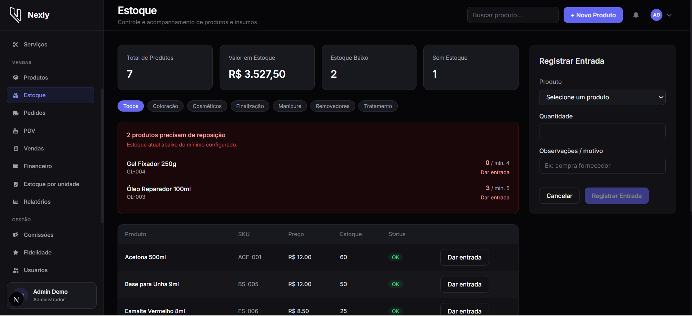</a>
</td>
</tr>
<tr>
<td width="50%" valign="top"><h4>Ponto de venda</h4>
<a href="docs/Screenshots/nexly-pdv.png">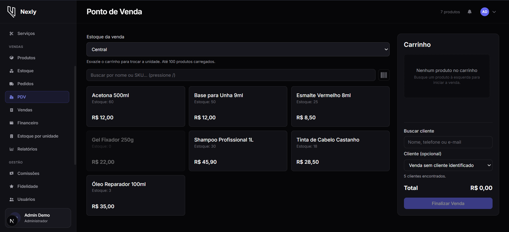</a>
</td>
<td width="50%" valign="top"><h4>Vendas</h4>
<a href="docs/Screenshots/nexly-vends.png">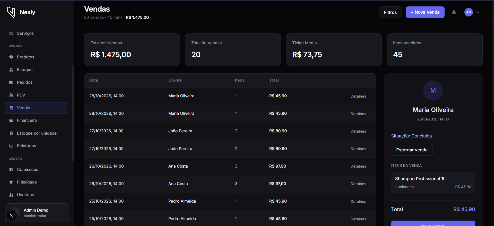</a>
</td>
</tr>
</table>

</details>

<details>
<summary><strong>Financeiro, relacionamento e unidades · 7 telas</strong></summary>

<table>
<tr>
<td width="50%" valign="top"><h4>Financeiro</h4>
<a href="docs/Screenshots/nexly-financeiro.png">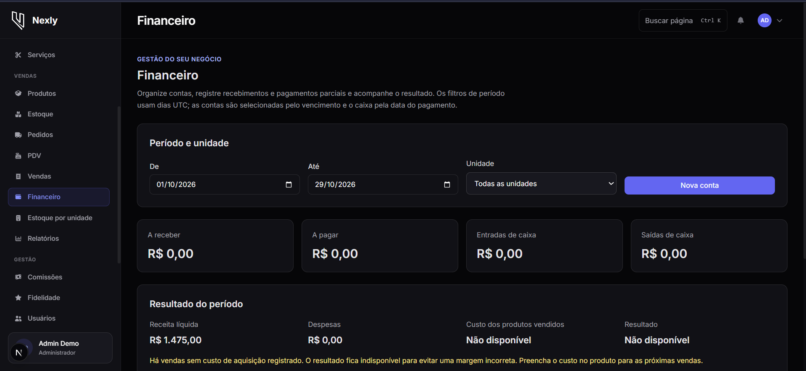</a>
</td>
<td width="50%" valign="top"><h4>Relatórios</h4>
<a href="docs/Screenshots/nexly-relatorios.png">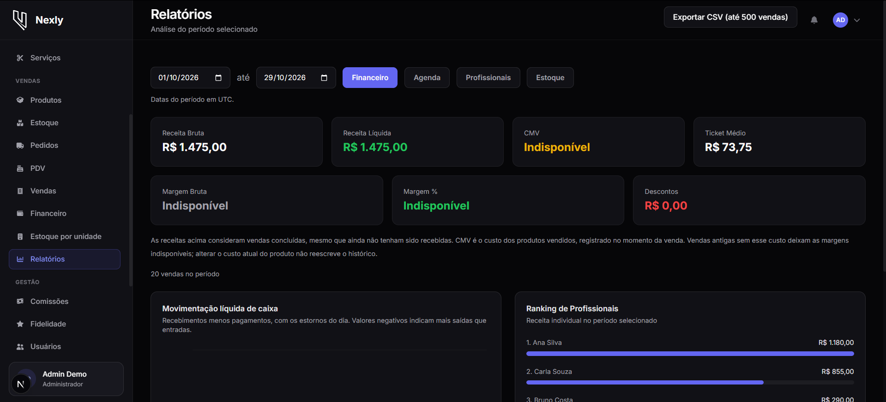</a>
</td>
</tr>
<tr>
<td width="50%" valign="top"><h4>Comissões</h4>
<a href="docs/Screenshots/nexly-comissoes.png">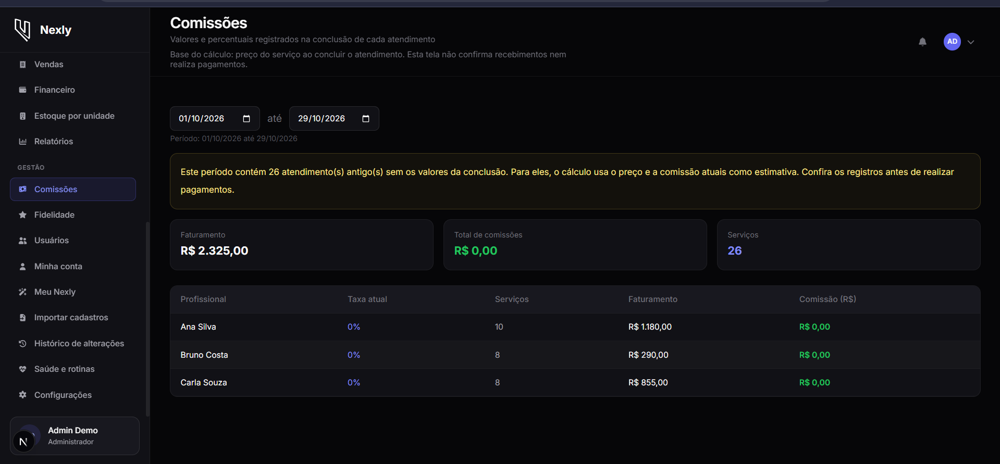</a>
</td>
<td width="50%" valign="top"><h4>Fidelidade</h4>
<a href="docs/Screenshots/nexly-fidelidade.png">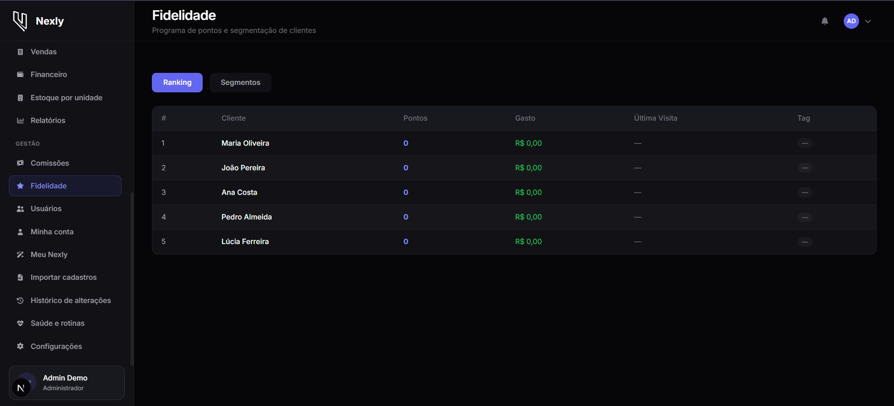</a>
</td>
</tr>
<tr>
<td width="50%" valign="top"><h4>Pedidos de compra</h4>
<a href="docs/Screenshots/nexly-pedidos_de_compra.png">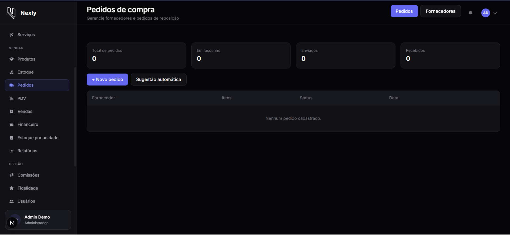</a>
</td>
<td width="50%" valign="top"><h4>Estoque por unidade</h4>
<a href="docs/Screenshots/nexly-estoque_por_unidade.png">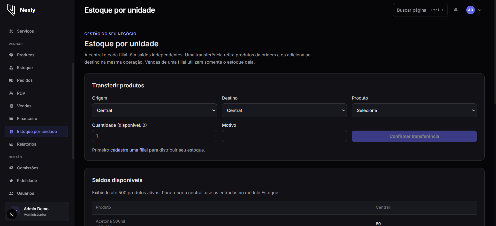</a>
</td>
</tr>
<tr>
<td width="50%" valign="top"><h4>Filiais</h4>
<a href="docs/Screenshots/nexly-filiais.png">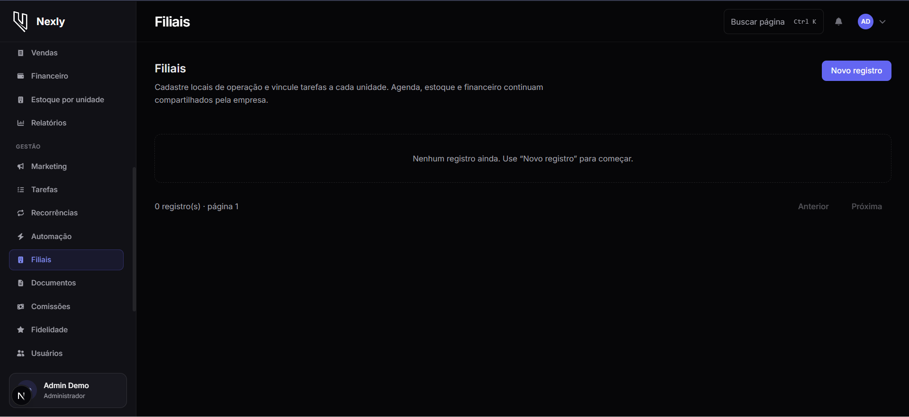</a>
</td>
</tr>
</table>

</details>

<details>
<summary><strong>Gestão e configuração do negócio · 11 telas</strong></summary>

<table>
<tr>
<td width="50%" valign="top"><h4>Automação</h4>
<a href="docs/Screenshots/nexly-automa%C3%A7%C3%A3o.png"></a>
</td>
<td width="50%" valign="top"><h4>Configurações</h4>
<a href="docs/Screenshots/nexly-configura%C3%A7%C3%B5es.png"></a>
</td>
</tr>
<tr>
<td width="50%" valign="top"><h4>Documentos</h4>
<a href="docs/Screenshots/nexly-documentos.png">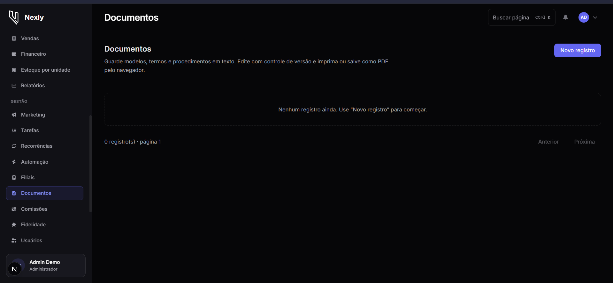</a>
</td>
<td width="50%" valign="top"><h4>Importação de cadastros</h4>
<a href="docs/Screenshots/nexly-importar_cadastro.png">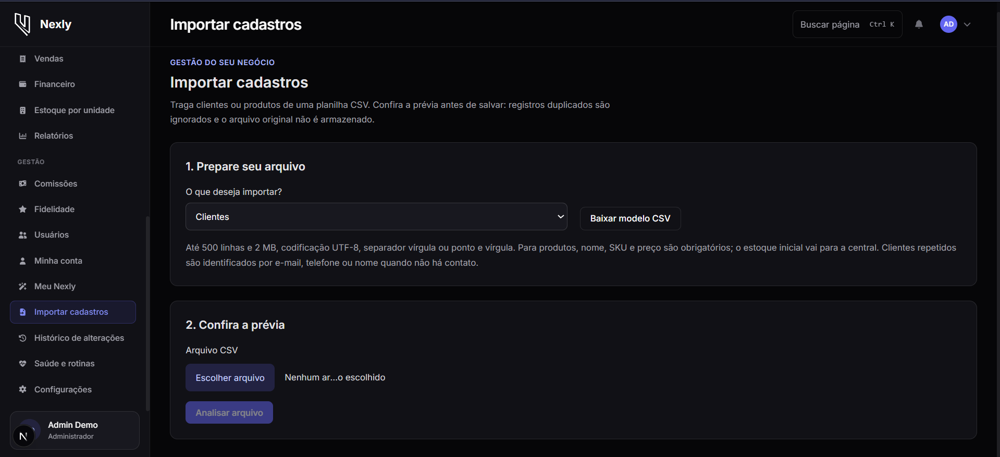</a>
</td>
</tr>
<tr>
<td width="50%" valign="top"><h4>Histórico de alterações</h4>
<a href="docs/Screenshots/nexly-historico_de_alteracoes.png">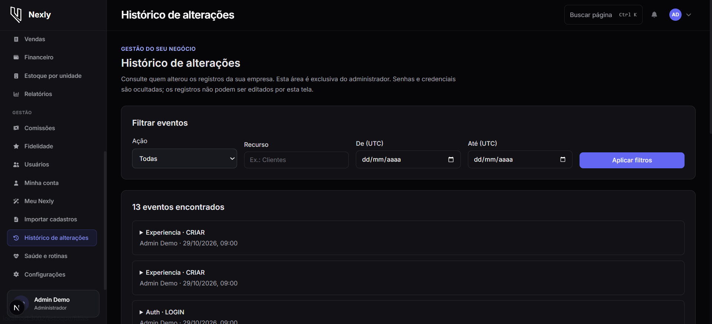</a>
</td>
<td width="50%" valign="top"><h4>Marketing</h4>
<a href="docs/Screenshots/nexly-marketing.png">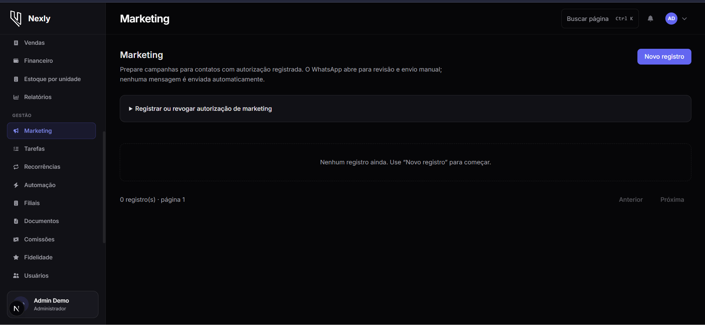</a>
</td>
</tr>
<tr>
<td width="50%" valign="top"><h4>Minha conta</h4>
<a href="docs/Screenshots/nexly-minha_conta.png">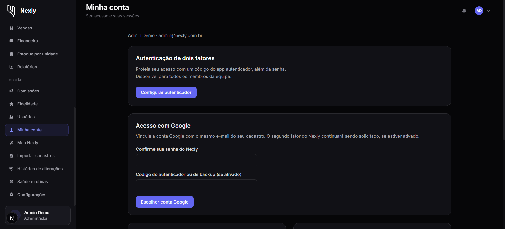</a>
</td>
<td width="50%" valign="top"><h4>Recorrência</h4>
<a href="docs/Screenshots/nexly-recorrencia.png">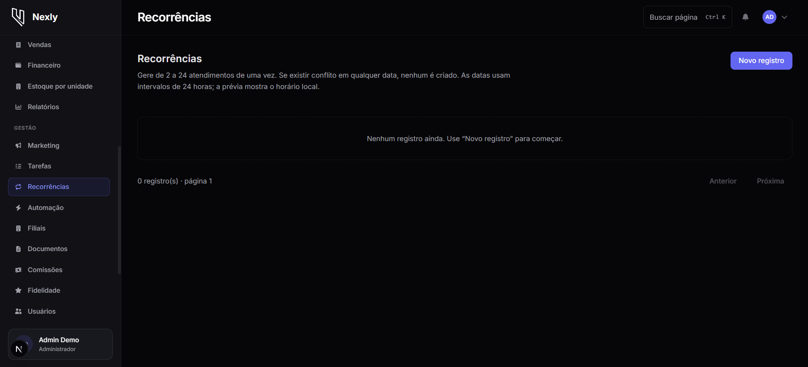</a>
</td>
</tr>
<tr>
<td width="50%" valign="top"><h4>Saúde e rotinas</h4>
<a href="docs/Screenshots/nexly-saude_e_rotinas.png">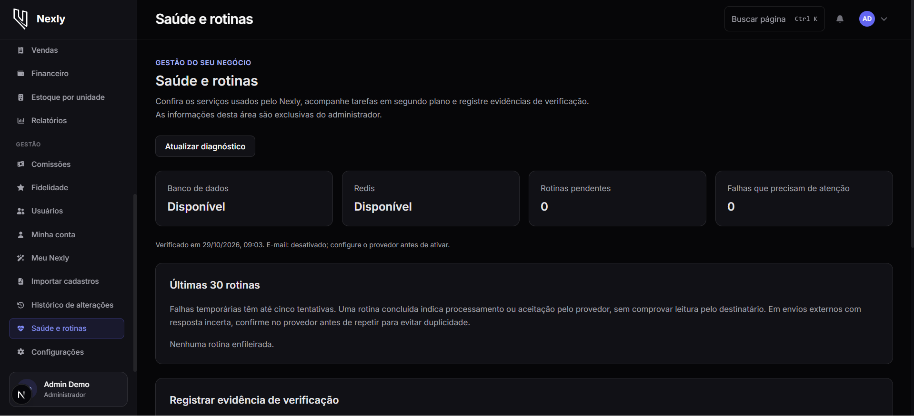</a>
</td>
<td width="50%" valign="top"><h4>Tarefas</h4>
<a href="docs/Screenshots/nexly-tarefas.png">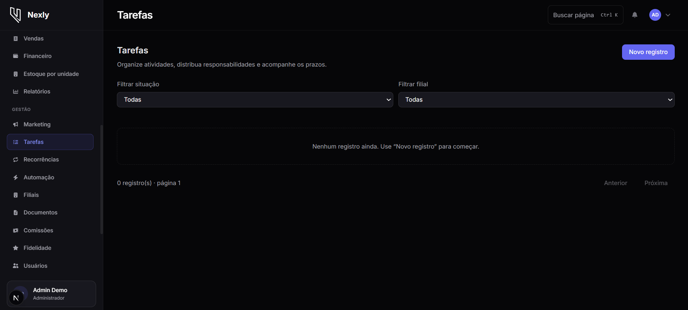</a>
</td>
</tr>
<tr>
<td width="50%" valign="top"><h4>Usuários</h4>
<a href="docs/Screenshots/nexly-usuarios.png">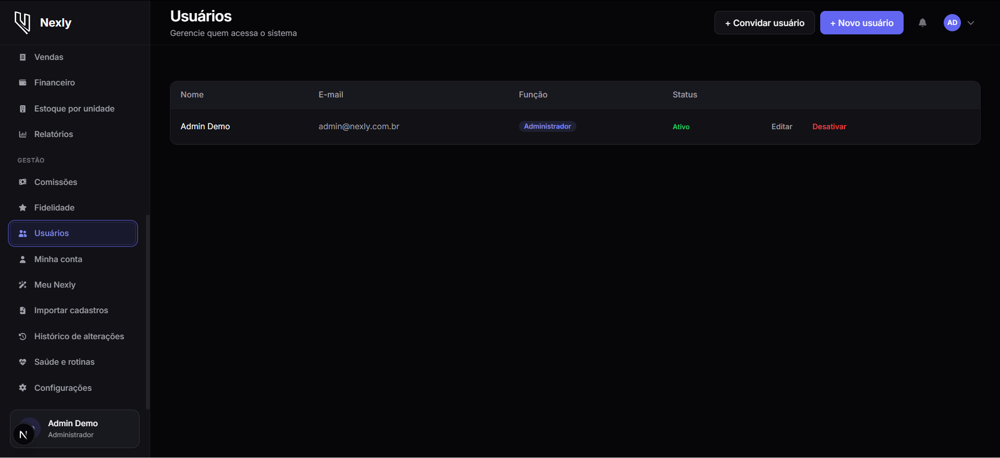</a>
</td>
</tr>
</table>

</details>

<details>
<summary><strong>Site institucional e acesso · 5 telas</strong></summary>

<table>
<tr>
<td width="50%" valign="top"><h4>Página inicial</h4>
<a href="docs/Screenshots/nexly-pagina_inicial.png">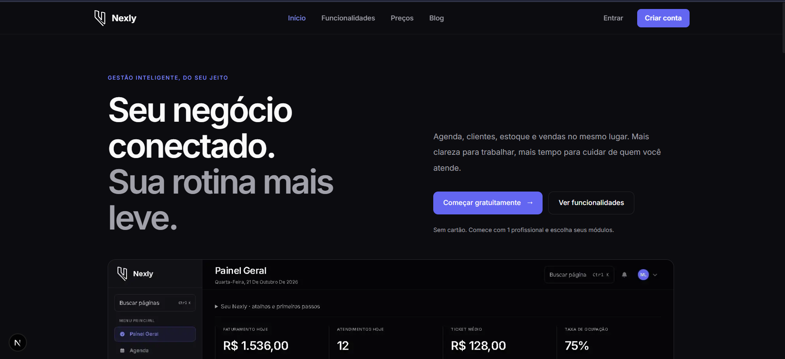</a>
</td>
<td width="50%" valign="top"><h4>Funcionalidades</h4>
<a href="docs/Screenshots/nexly-funcionalidades.png">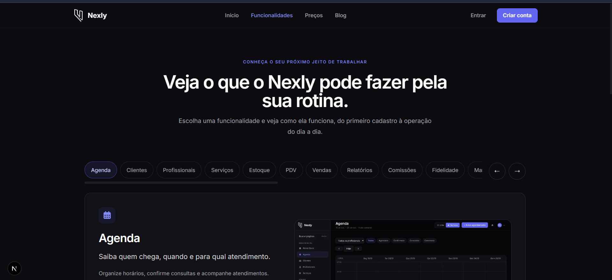</a>
</td>
</tr>
<tr>
<td width="50%" valign="top"><h4>Planos e preços</h4>
<a href="docs/Screenshots/nexly-preco.png">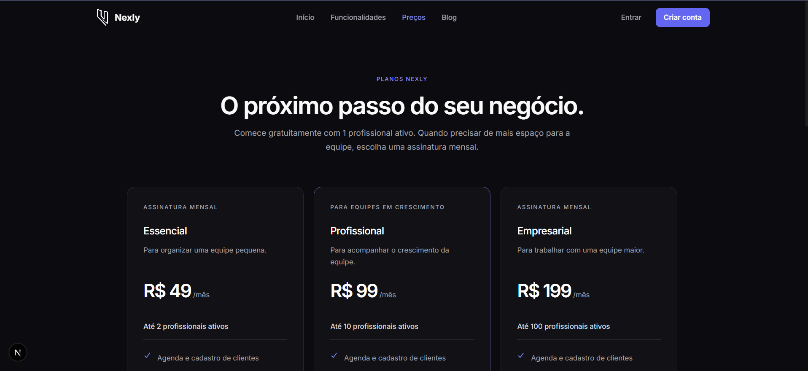</a>
</td>
<td width="50%" valign="top"><h4>Blog</h4>
<a href="docs/Screenshots/nexly-blog.png">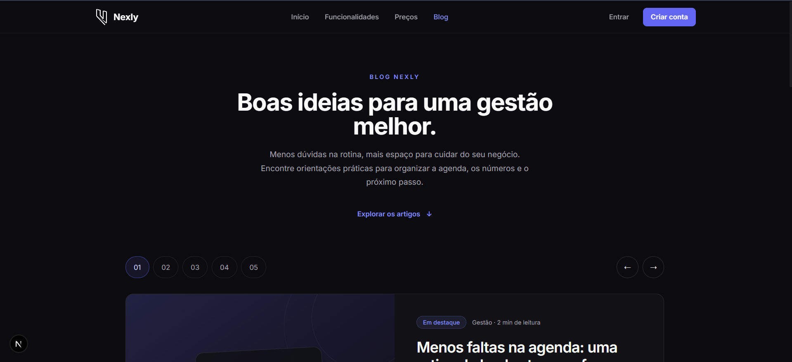</a>
</td>
</tr>
<tr>
<td width="50%" valign="top"><h4>Login e cadastro</h4>
<a href="docs/Screenshots/nexly-login_e_cadastro.png">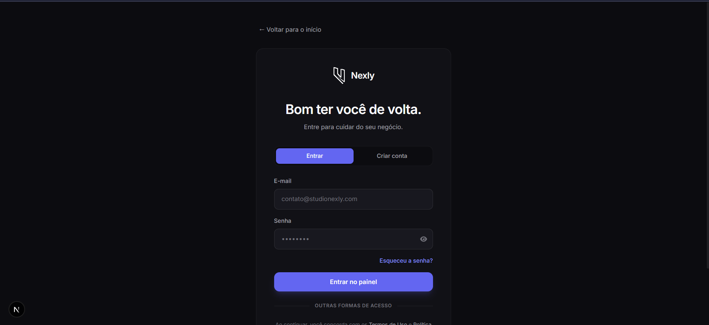</a>
</td>
</tr>
</table>

</details>

[Voltar ao topo](#topo)

---

<a id="site"></a>

## 5. Site e experiência pública

<div align="center">

<a href="https://nexly-web.vercel.app"></a>
<a href="https://nexly-web.vercel.app/funcionalidades"></a>
<a href="https://nexly-web.vercel.app/precos"></a>

</div>

| Página                                                                                                  | Finalidade                                        |
| ------------------------------------------------------------------------------------------------------- | ------------------------------------------------- |
| [Início](https://nexly-web.vercel.app)                                                                  | Produto, segmentos e conexão entre os módulos.    |
| [Funcionalidades](https://nexly-web.vercel.app/funcionalidades)                                         | Recursos e seus passos de uso.                    |
| [Preços](https://nexly-web.vercel.app/precos)                                                           | Planos e limites de profissionais.                |
| [Blog](https://nexly-web.vercel.app/blog)                                                               | Artigos, categorias e conteúdos de gestão.        |
| [Entrar](https://nexly-web.vercel.app/login)                                                            | Acesso a uma conta existente.                     |
| [Criar conta](https://nexly-web.vercel.app/cadastro)                                                    | Configuração de conta e negócio em quatro etapas. |
| [Suporte](https://nexly-web.vercel.app/suporte)                                                         | Orientações e contato de atendimento.             |
| [Termos](https://nexly-web.vercel.app/termos) e [privacidade](https://nexly-web.vercel.app/privacidade) | Informações publicadas sobre uso e dados.         |

O cadastro considera conta e empresa, segmento, recursos e aceite das condições. A configuração pode ser revista em Meu Nexly. Web e API são publicadas separadamente; o link do site não comprova disponibilidade contínua de todas as dependências.

[Voltar ao topo](#topo)

---

<a id="figma"></a>

## 6. Figma e identidade visual

<div align="center">

<a href="https://www.figma.com/design/nZXYARpSTmoeK3Gg7P0apb/Nexly?node-id=0-1"></a>
<a href="capturas/video_figma.mp4"></a>

</div>

A prototipação orientou a navegação, os componentes e a identidade visual. A aplicação utiliza **Inter**, superfícies escuras e índigo nos destaques, com adaptações para computador e celular.

| Elemento                | Referência                                                       |
| ----------------------- | ---------------------------------------------------------------- |
| Tipografia da interface | Inter.                                                           |
| Fundo principal         | `#060608`.                                                       |
| Superfícies             | `#111116` e `#18181F`.                                           |
| Texto principal         | `#FAFAFA`.                                                       |
| Destaques e ações       | `#6366F1`.                                                       |
| Composição              | Navegação lateral no desktop e componentes adaptados ao celular. |

<details>
<summary><strong>Ver as referências históricas de prototipação</strong></summary>

Estas imagens foram preservadas como registro da etapa de design. Podem apresentar nomes, valores e estruturas anteriores. As capturas atuais estão no tour visual.

<table>
  <tr>
    <td width="50%"><a href="capturas/captura1.png"></a><p align="center">Apresentação inicial do protótipo</p></td>
    <td width="50%"><a href="capturas/capturas2.png"></a><p align="center">Funcionalidades no protótipo</p></td>
  </tr>
  <tr>
    <td width="50%"><a href="capturas/capturas3.png">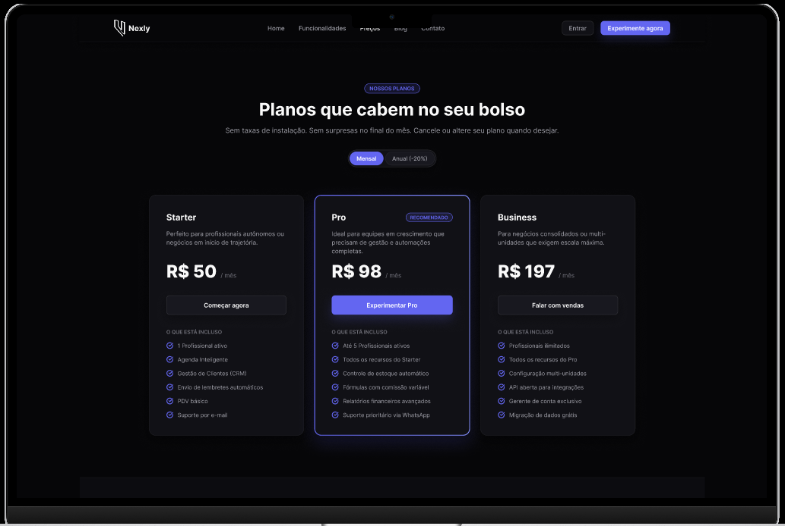</a><p align="center">Estudo de planos — valores históricos</p></td>
    <td width="50%"><a href="capturas/capturas4.png">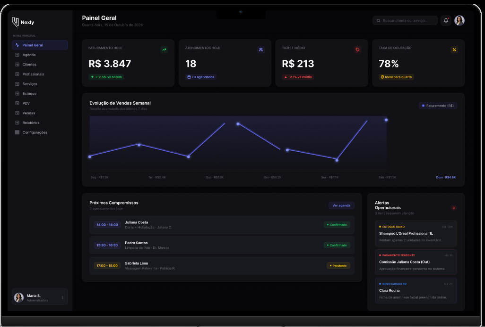</a><p align="center">Estudo do painel</p></td>
  </tr>
</table>

</details>

A manutenção considera rótulos, foco, teclado, carregamento, mensagens de erro e preferência por movimento reduzido. Essas práticas não equivalem a certificação formal de acessibilidade.

[Voltar ao topo](#topo)

---

<a id="planos"></a>

## 7. Planos e assinaturas

Os valores abaixo correspondem ao catálogo documentado nesta revisão. O pacote compartilhado define os limites de profissionais e o backend mantém as regras de cobrança.

| Plano            | Código       | Mensalidade | Profissionais ativos por empresa |
| ---------------- | ------------ | ----------- | -------------------------------- |
| **Gratuito**     | `FREE`       | **R$ 0**    | 1                                |
| **Essencial**    | `BASIC`      | **R$ 49**   | 2                                |
| **Profissional** | `PRO`        | **R$ 99**   | 10                               |
| **Empresarial**  | `ENTERPRISE` | **R$ 199**  | 100                              |

A cota é compartilhada entre unidades. Profissionais cadastrados são distintos de contas de login e acessos simultâneos. Selecionar um plano na interface não confirma pagamento nem concede acesso pago.

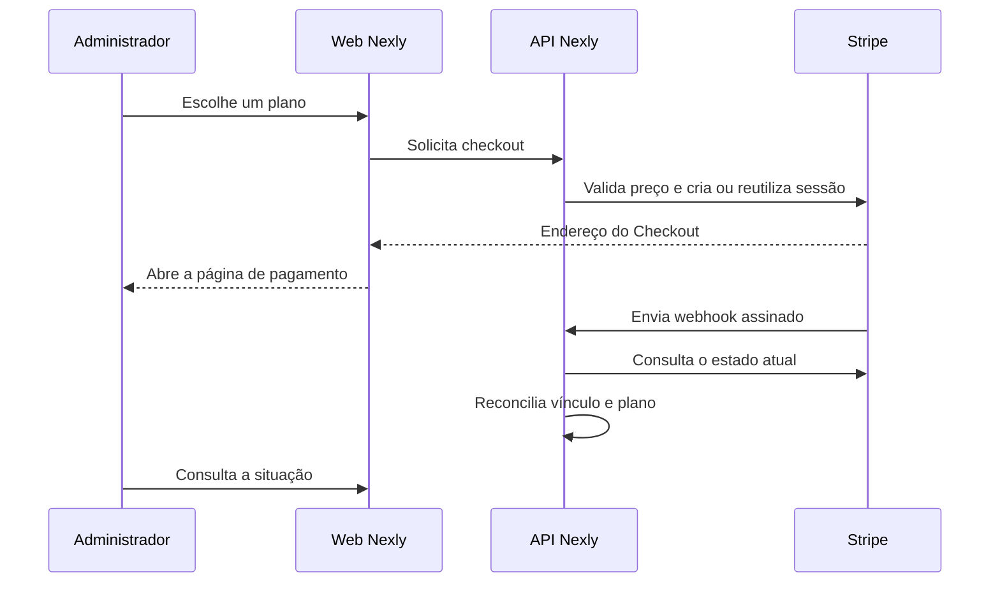

- O Stripe processa a **assinatura do Nexly**; vendas dos estabelecimentos no PDV têm outro propósito.
- Checkout e Customer Portal dependem do ambiente e do perfil autorizado.
- O retorno do checkout não comprova pagamento: webhook e reconciliação consultam o provedor.
- Há reconciliação agendada por empresa e ambiente, com fila persistida e deduplicação.
- `test` registra homologação sem alterar o plano comercial de produção. A mudança comercial ocorre no fluxo `live` com as condições exigidas.

[Limites compartilhados](packages/shared/src/plans.ts) · [Guia de pagamentos](docs/PAGAMENTOS.md) · [Módulo de assinaturas](apps/api/src/assinaturas)

[Voltar ao topo](#topo)

---

<a id="arquitetura"></a>

## 8. Arquitetura e caminho dos dados

O **monorepositório** reúne interface, API e pacotes compartilhados. npm Workspaces gerencia os pacotes; Turborepo organiza as tarefas.

```mermaid
flowchart TB
    U[Pessoa no navegador] --> W[Web — Next.js e React]
