<a id="topo"></a>

<div align="center">

<picture>
  <source media="(prefers-color-scheme: dark)" srcset="apps/web/public/logo.svg">
  
</picture>

# Nexly

### Gestão conectada para pequenos negócios

**Agenda, clientes, serviços, estoque, vendas e financeiro em uma única plataforma.**

Um SaaS multiempresa para organizar o atendimento e acompanhar o negócio — do primeiro agendamento ao consumo de materiais e ao registro da venda.

<p>
  <a href="https://nexly-web.vercel.app"></a>
  <a href="#documentacao"></a>
  <a href="https://www.figma.com/design/nZXYARpSTmoeK3Gg7P0apb/Nexly?node-id=0-1"></a>
  <a href="#instalacao"></a>
</p>

<p>
  
  
  
  
  
  
  
</p>

<p>
  <a href="https://github.com/Breno-J-Oliveira/Nexly/actions/workflows/ci.yml"></a>
  
  
  
</p>

<a href="docs/Screenshots/nexly-painel_geral.png">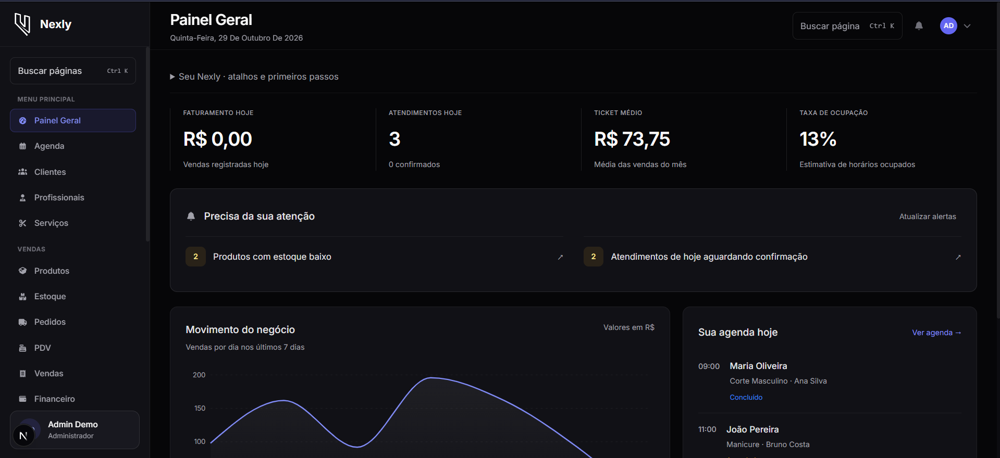</a>

<sub>Aplicação atual com dados de demonstração. Valores ilustrativos não representam resultados de clientes.</sub>

**NexusTech · Técnico em Desenvolvimento de Sistemas · SENAI “A. Jacob Lafer” · 2026**

</div>

---

## Navegação

| Conhecer o produto                     | Explorar a implementação                | Executar e acompanhar                    |
| -------------------------------------- | --------------------------------------- | ---------------------------------------- |
| [Visão geral](#visao-geral)            | [Arquitetura](#arquitetura)             | [Instalação local](#instalacao)          |
| [Jornadas de uso](#jornadas)           | [Stack tecnológica](#stack)             | [Variáveis de ambiente](#ambiente)       |
| [Funcionalidades](#funcionalidades)    | [Banco, MER e DER](#dados)              | [Comandos úteis](#comandos)              |
| [Tour visual e galeria](#galeria)      | [API REST](#api)                        | [Testes e evidências](#testes)           |
| [Site e páginas públicas](#site)       | [Autenticação e permissões](#acesso)    | [CI, publicação e operação](#operacao)   |
| [Figma e identidade visual](#figma)    | [Segurança e privacidade](#seguranca)   | [Diagnóstico de problemas](#diagnostico) |
| [Planos e assinaturas](#planos)        | [Integrações e NexusAuth](#integracoes) | [Documentação](#documentacao)            |
| [Equipe e contexto acadêmico](#equipe) | [Estrutura do repositório](#estrutura)  | [Roadmap e contribuições](#roadmap)      |

**Primeira visita?** Comece pela visão geral e pelo tour visual. **Vai desenvolver?** Leia arquitetura, instalação e API. **Vai avaliar a entrega?** Consulte os documentos acadêmicos e as evidências.

---

<a id="visao-geral"></a>

## 1. Visão geral

O **Nexly** é uma aplicação web de gestão para pequenos negócios que trabalham com atendimentos, serviços e venda de produtos. Reúne informações que normalmente ficam separadas em agendas, planilhas e anotações: clientes, profissionais, horários, estoque, vendas e contas.

**SaaS** significa que o produto é oferecido como um serviço acessado pelo navegador. **Multiempresa**, ou _multi-tenant_, significa que várias empresas utilizam a mesma aplicação, com seus registros e acessos delimitados pelo contexto de cada negócio.

### Para quem foi pensado

| Segmento                               | Exemplos de uso                                          |
| -------------------------------------- | -------------------------------------------------------- |
| Salões de beleza                       | Profissionais, serviços, horários e consumo de produtos. |
| Barbearias                             | Agenda, venda de produtos e consulta de comissões.       |
| Petshops                               | Relacionamento com clientes, atendimentos e produtos.    |
| Estúdios e profissionais autônomos     | Contatos e rotina de atendimento centralizados.          |
| Negócios de estética e outros serviços | Seleção de módulos e linguagem conforme a operação.      |

Os segmentos orientam a configuração inicial. Escolher um preset não transforma o Nexly em prontuário clínico, sistema fiscal ou solução especializada para uma atividade regulada.

### Qual problema ele resolve

| Na rotina do negócio                      | No Nexly                                       |
| ----------------------------------------- | ---------------------------------------------- |
| Horários e contatos espalhados            | Agenda integrada aos cadastros.                |
| Material consumido sem histórico          | Serviços associados a insumos e movimentações. |
| Estoque desconectado das vendas           | PDV, produtos e saldo relacionados pela API.   |
| Dificuldade para acompanhar pendências    | Indicadores e alertas do negócio.              |
| Funções que a empresa não utiliza         | Escolha de módulos e personalização inicial.   |
| Acessos sem distinção de responsabilidade | Perfis e permissões verificados no backend.    |

### O que cada público encontra

- **Administração:** indicadores, agenda, estoque, vendas, contas e configuração da empresa.
- **Equipe:** recursos de atendimento e caixa liberados conforme o papel e os módulos.
- **Clientes do estabelecimento:** agendamento público quando configurado.
- **Desenvolvimento:** monorepositório TypeScript, API NestJS, schema Prisma, migrações e testes.

[Voltar ao topo](#topo)

---

<a id="jornadas"></a>

## 2. Diferencial e jornadas de uso

### Do atendimento ao estoque

O diferencial central é a ligação entre **serviços e insumos**. Um serviço pode consumir quantidades definidas de um ou mais produtos. Ao concluir o atendimento, o sistema processa esse consumo e mantém o histórico correspondente.

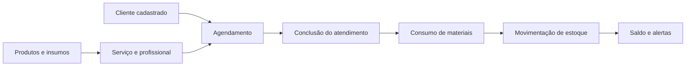

**Exemplo:** um serviço de coloração utiliza uma unidade de tinta cadastrada como insumo. Depois de concluir o agendamento, a saída é registrada no estoque. Repetir uma solicitação não deve consumir novamente o mesmo material. Uma falta prevista pode gerar pendência de consumo; erros internos inesperados devem reverter a transação.

| Jornada              | Passos                                                                               | Resultado que pode ser conferido                           |
| -------------------- | ------------------------------------------------------------------------------------ | ---------------------------------------------------------- |
| Primeiro atendimento | Configurar negócio → cadastrar cliente, profissional e serviço → agendar → concluir. | Atendimento registrado e consumo dos insumos configurados. |
| Venda no balcão      | Cadastrar produto → montar carrinho → informar cliente e pagamento → finalizar.      | Venda, itens e movimentação de estoque persistidos.        |
| Reposição            | Cadastrar fornecedor → criar pedido → enviar → receber.                              | Estado do pedido e entrada dos produtos.                   |

O PDV registra a forma de pagamento informada. Esse registro não realiza, por si só, uma transferência Pix nem uma cobrança em uma adquirente.

[Voltar ao topo](#topo)

---

<a id="funcionalidades"></a>

## 3. Funcionalidades

As áreas abaixo têm implementação no repositório. O acesso depende das permissões, da configuração da empresa e, quando aplicável, de integrações externas.

### Atendimento e relacionamento

| Área                   | O que oferece                                                                 |
| ---------------------- | ----------------------------------------------------------------------------- |
| **Painel geral**       | Indicadores, agenda do dia, estoque e pendências financeiras conforme acesso. |
| **Agenda**             | Criação, confirmação, conclusão, cancelamento, disponibilidade e conflitos.   |
| **Clientes**           | Contatos, busca, observações, métricas e histórico.                           |
| **Profissionais**      | Equipe, especialidades, disponibilidade e limites ativos por plano.           |
| **Serviços**           | Preço, duração e associação de insumos.                                       |
| **Agendamento online** | Link público por empresa, serviços e horários disponíveis.                    |
| **Fidelidade**         | Pontos, ranking e acompanhamento do relacionamento.                           |
| **Comissões**          | Valores e histórico de cálculo; o repasse ao profissional é externo.          |

### Vendas, estoque e financeiro

| Área                       | O que oferece                                                    |
| -------------------------- | ---------------------------------------------------------------- |
| **Produtos**               | Cadastro, SKU, categoria, preço e informações de estoque.        |
| **Estoque**                | Entradas, saídas, reposição, validade e pendências de consumo.   |
| **PDV**                    | Carrinho, cliente, desconto, pagamento e finalização.            |
| **Vendas**                 | Histórico, itens, filtros e estorno conforme regras e permissão. |
| **Fornecedores e compras** | Fornecedores, pedidos, rascunhos e recebimento.                  |
| **Financeiro**             | Receitas, despesas, vencimentos, baixas e pagamentos parciais.   |
| **Estoque por unidade**    | Saldos e transferências entre a central e as filiais.            |
| **Relatórios**             | Vendas, caixa, agenda, profissionais e materiais.                |
| **Cupons**                 | Condições de desconto nos fluxos permitidos.                     |

### Gestão e operação

| Área                          | O que oferece                                                                      |
| ----------------------------- | ---------------------------------------------------------------------------------- |
| **Filiais**                   | Unidades e associação das operações correspondentes.                               |
| **Tarefas**                   | Prioridade, responsável, prazo e unidade.                                          |
| **Recorrências**              | Séries de atendimentos e ocorrências futuras.                                      |
| **Automação**                 | Geração de tarefas recorrentes com controle de duplicidade.                        |
| **Documentos**                | Conteúdo operacional, versões e impressão/PDF; sem assinatura digital incorporada. |
| **Marketing**                 | Campanhas e contatos autorizados para abordagem manual por WhatsApp.               |
| **Importação**                | Preparação e conferência de CSV nos fluxos disponíveis.                            |
| **Histórico de alterações**   | Eventos de auditoria conforme permissão.                                           |
| **Saúde e rotinas**           | Dependências, trabalhos e registros de verificação.                                |
| **Usuários e conta**          | Equipe, convites, sessões, senha, segundo fator e Google configurável.             |
| **Meu Nexly e configurações** | Módulos, preset, perfil, horários e notificações.                                  |

As dependências entre módulos são consideradas na configuração. A agenda, por exemplo, utiliza clientes, profissionais e serviços. Referência: [`workspace.ts`](packages/shared/src/workspace.ts).

[Voltar ao topo](#topo)

---

<a id="galeria"></a>

## 4. Tour visual da aplicação

As imagens vieram das **32 capturas atuais fornecidas pelo autor**, em [`docs/Screenshots`](docs/Screenshots). O painel aparece na capa; as demais telas estão nas galerias abaixo. Clique em uma imagem para abrir o original.

Algumas capturas mostram listas vazias, valores estimados ou informações indisponíveis, conforme o estado fotografado. São exemplos da interface com massa de demonstração, não provas de resultados de clientes.

### Agenda e ponto de venda

<a href="docs/Screenshots/nexly-agenda.png"></a>

_Agenda: horários, profissionais e estados dos atendimentos em uma mesma tela._

<a href="docs/Screenshots/nexly-pdv.png">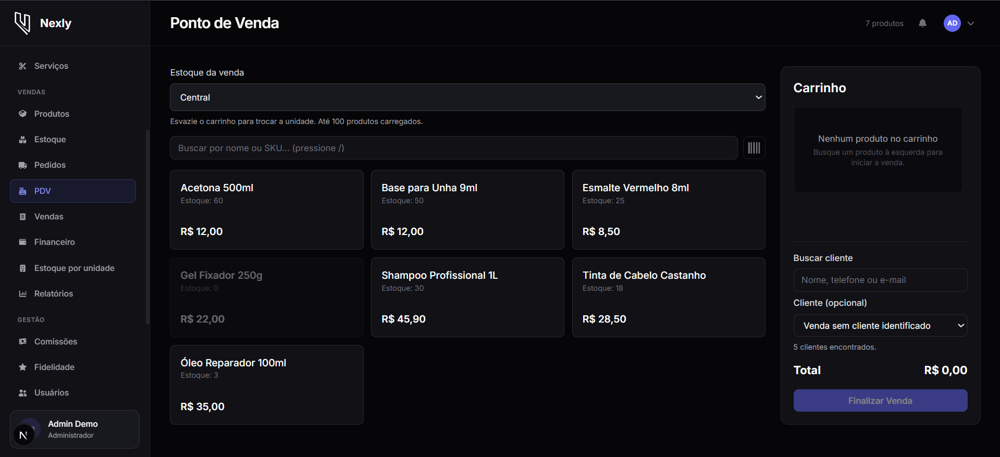</a>

_PDV: escolha de produtos, montagem do carrinho e registro da venda._

<details>
<summary><strong>Atendimento, catálogo e operação · 8 telas</strong></summary>

<table>
<tr>
<td width="50%" valign="top"><h4>Agenda</h4>
<a href="docs/Screenshots/nexly-agenda.png">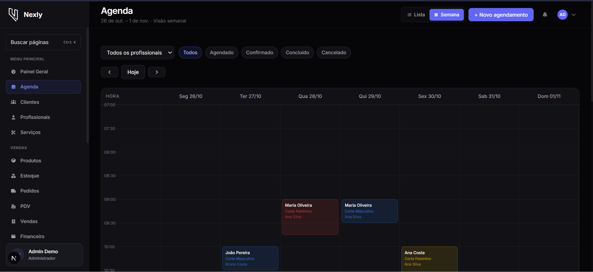</a>
</td>
<td width="50%" valign="top"><h4>Clientes</h4>
<a href="docs/Screenshots/nexly-clientes.png">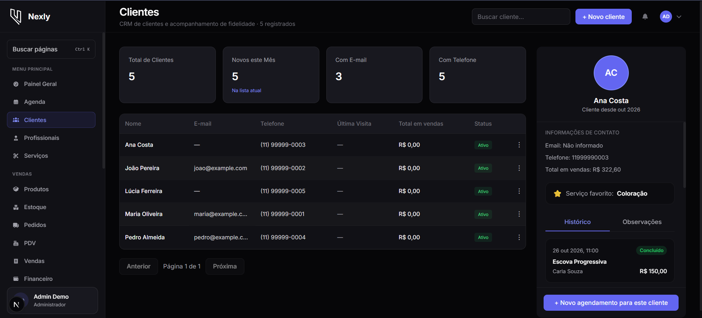</a>
</td>
</tr>
<tr>
<td width="50%" valign="top"><h4>Profissionais</h4>
<a href="docs/Screenshots/nexly-profissionais.png">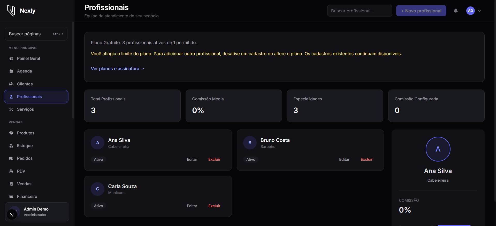</a>
</td>
<td width="50%" valign="top"><h4>Serviços</h4>
<a href="docs/Screenshots/nexly-servi%C3%A7os.png"></a>
</td>
</tr>
<tr>
<td width="50%" valign="top"><h4>Produtos</h4>
<a href="docs/Screenshots/nexly-produtos.png">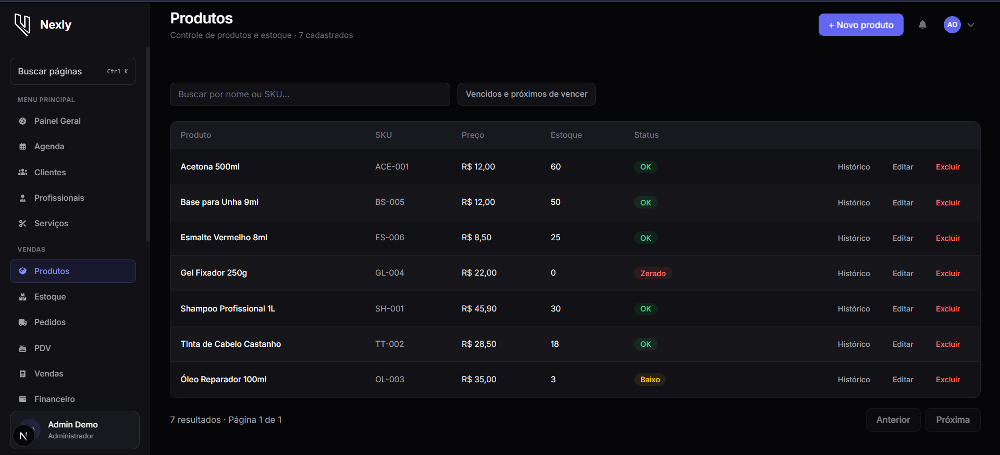</a>
</td>
<td width="50%" valign="top"><h4>Estoque</h4>
<a href="docs/Screenshots/nexly-estoque.png">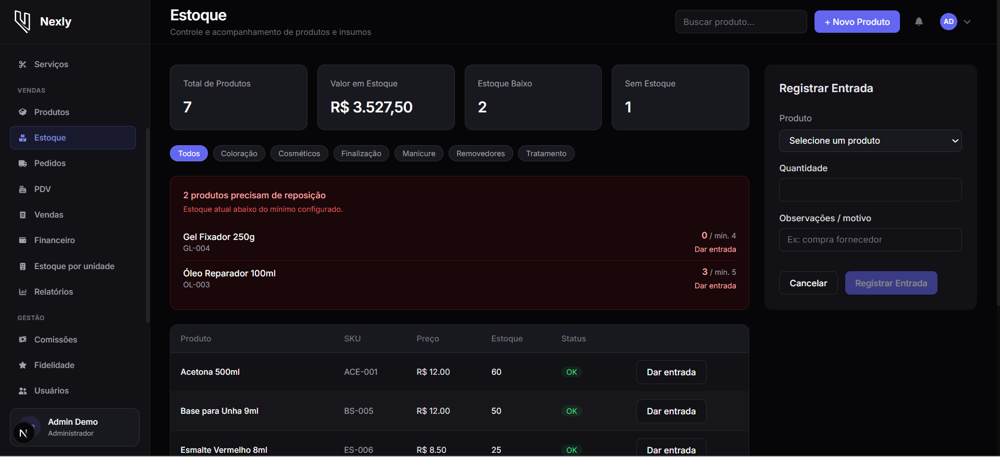</a>
</td>
</tr>
<tr>
<td width="50%" valign="top"><h4>Ponto de venda</h4>
<a href="docs/Screenshots/nexly-pdv.png"></a>
</td>
<td width="50%" valign="top"><h4>Vendas</h4>
<a href="docs/Screenshots/nexly-vends.png">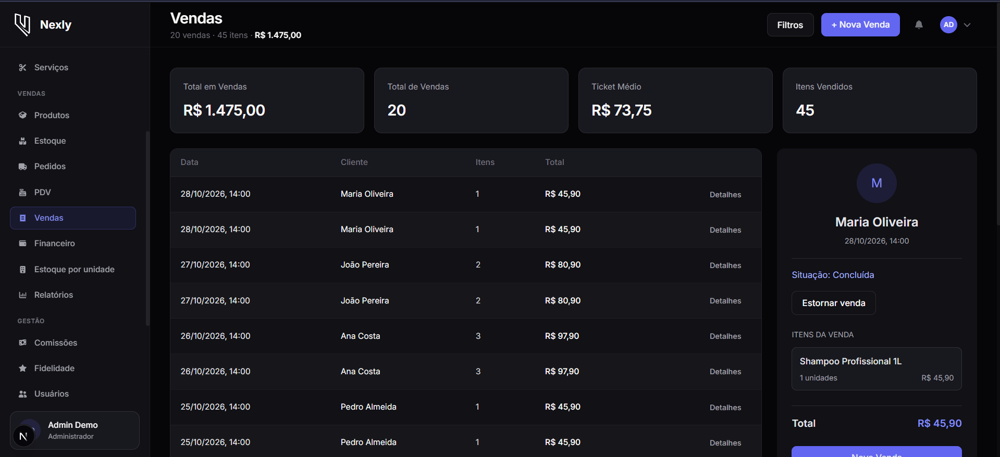</a>
</td>
</tr>
</table>

</details>

<details>
<summary><strong>Financeiro, relacionamento e unidades · 7 telas</strong></summary>

<table>
<tr>
<td width="50%" valign="top"><h4>Financeiro</h4>
<a href="docs/Screenshots/nexly-financeiro.png">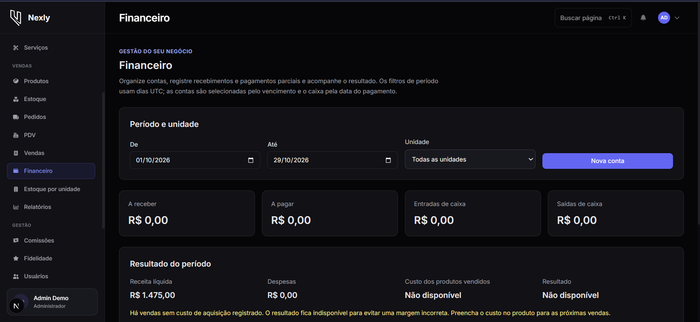</a>
</td>
<td width="50%" valign="top"><h4>Relatórios</h4>
<a href="docs/Screenshots/nexly-relatorios.png">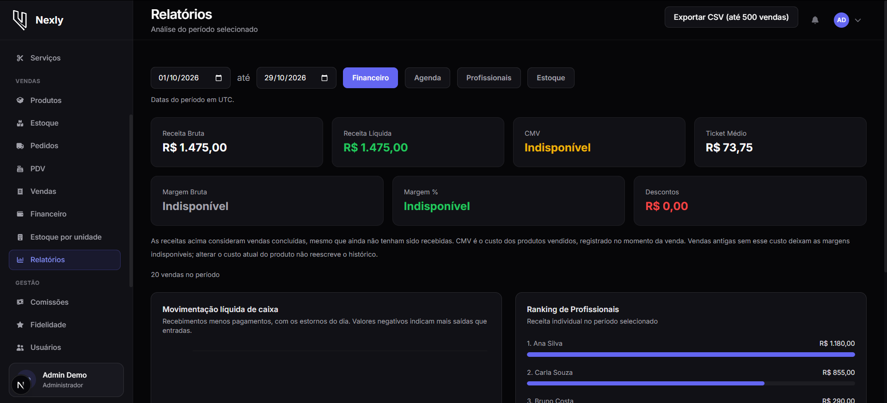</a>
</td>
</tr>
<tr>
<td width="50%" valign="top"><h4>Comissões</h4>
<a href="docs/Screenshots/nexly-comissoes.png">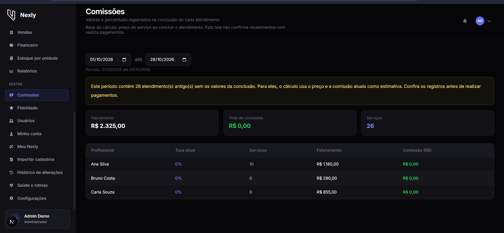</a>
</td>
<td width="50%" valign="top"><h4>Fidelidade</h4>
<a href="docs/Screenshots/nexly-fidelidade.png">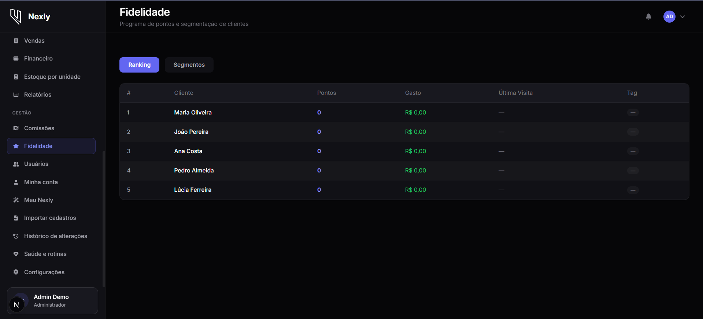</a>
</td>
</tr>
<tr>
<td width="50%" valign="top"><h4>Pedidos de compra</h4>
<a href="docs/Screenshots/nexly-pedidos_de_compra.png">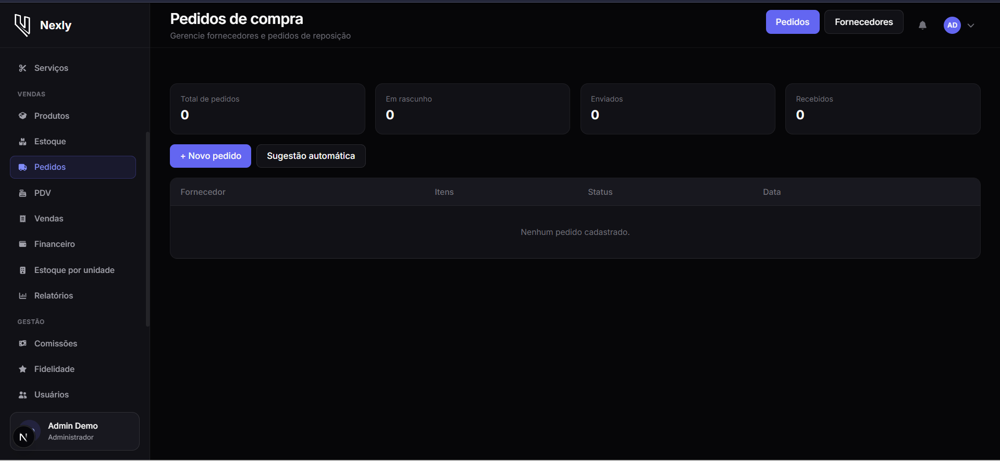</a>
</td>
<td width="50%" valign="top"><h4>Estoque por unidade</h4>
<a href="docs/Screenshots/nexly-estoque_por_unidade.png">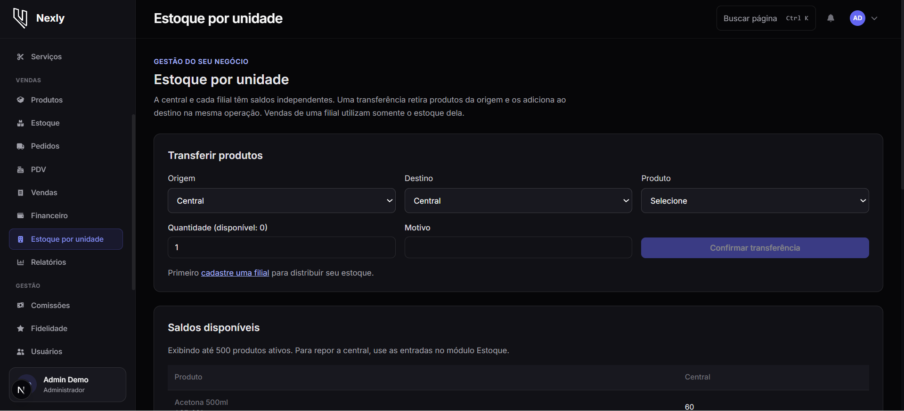</a>
</td>
</tr>
<tr>
<td width="50%" valign="top"><h4>Filiais</h4>
<a href="docs/Screenshots/nexly-filiais.png">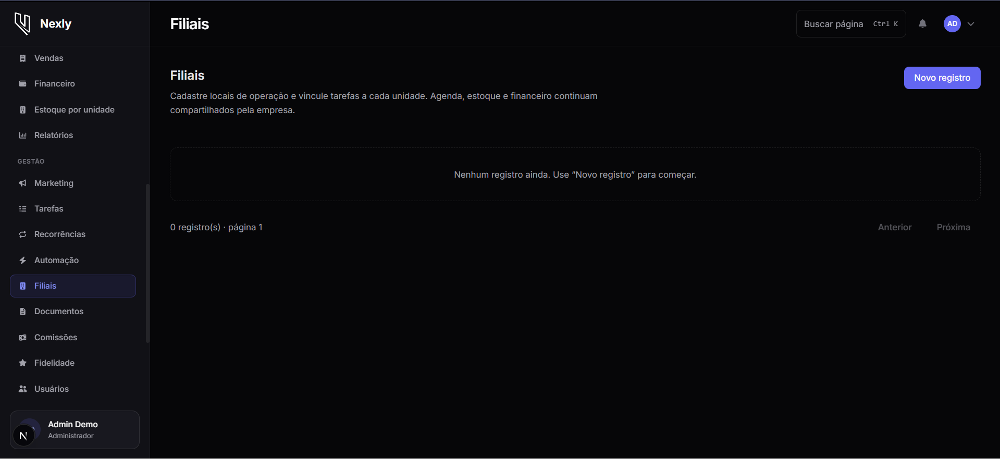</a>
</td>
</tr>
</table>

</details>

<details>
<summary><strong>Gestão e configuração do negócio · 11 telas</strong></summary>

<table>
<tr>
<td width="50%" valign="top"><h4>Automação</h4>
<a href="docs/Screenshots/nexly-automa%C3%A7%C3%A3o.png"></a>
</td>
<td width="50%" valign="top"><h4>Configurações</h4>
<a href="docs/Screenshots/nexly-configura%C3%A7%C3%B5es.png"></a>
</td>
</tr>
<tr>
<td width="50%" valign="top"><h4>Documentos</h4>
<a href="docs/Screenshots/nexly-documentos.png">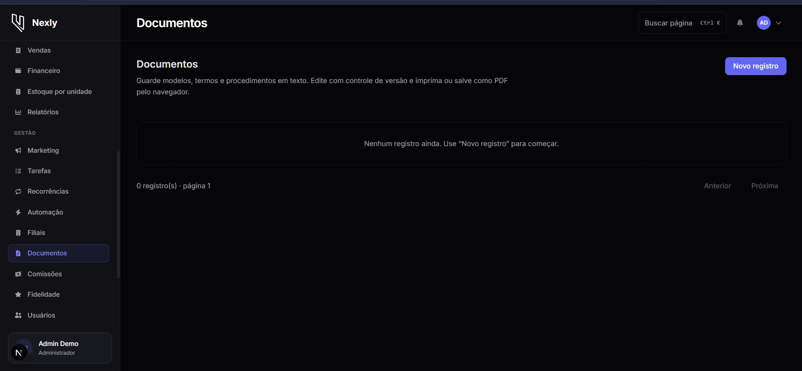</a>
</td>
<td width="50%" valign="top"><h4>Importação de cadastros</h4>
<a href="docs/Screenshots/nexly-importar_cadastro.png">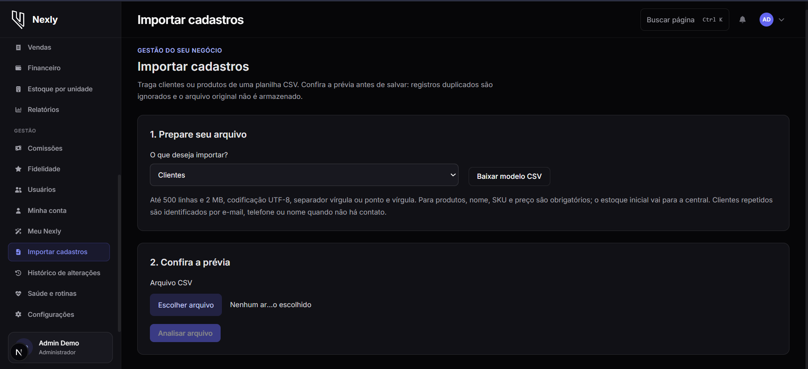</a>
</td>
</tr>
<tr>
<td width="50%" valign="top"><h4>Histórico de alterações</h4>
<a href="docs/Screenshots/nexly-historico_de_alteracoes.png">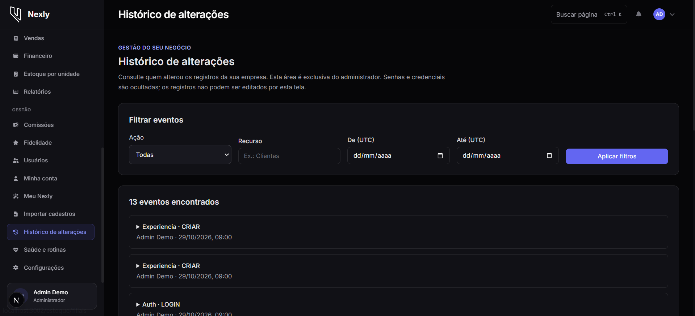</a>
</td>
<td width="50%" valign="top"><h4>Marketing</h4>
<a href="docs/Screenshots/nexly-marketing.png">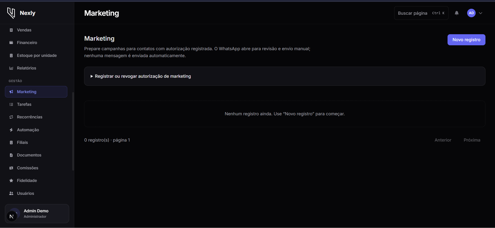</a>
</td>
</tr>
<tr>
<td width="50%" valign="top"><h4>Minha conta</h4>
<a href="docs/Screenshots/nexly-minha_conta.png">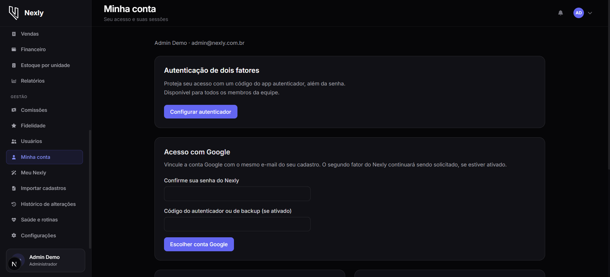</a>
</td>
<td width="50%" valign="top"><h4>Recorrência</h4>
<a href="docs/Screenshots/nexly-recorrencia.png">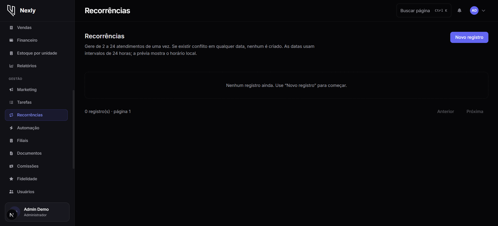</a>
</td>
</tr>
<tr>
<td width="50%" valign="top"><h4>Saúde e rotinas</h4>
<a href="docs/Screenshots/nexly-saude_e_rotinas.png">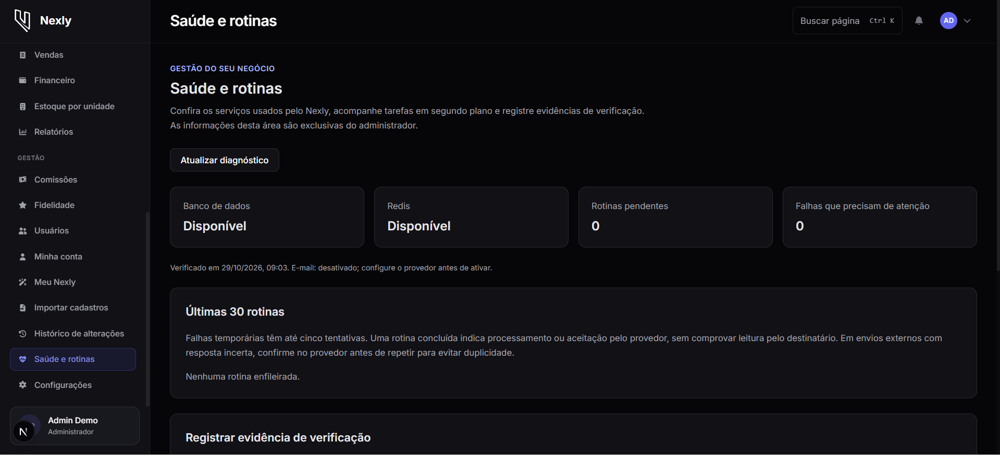</a>
</td>
<td width="50%" valign="top"><h4>Tarefas</h4>
<a href="docs/Screenshots/nexly-tarefas.png">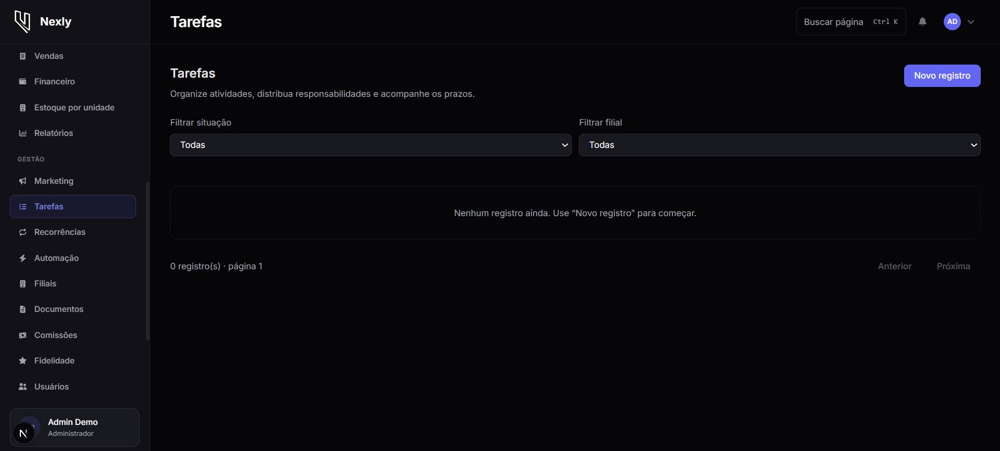</a>
</td>
</tr>
<tr>
<td width="50%" valign="top"><h4>Usuários</h4>
<a href="docs/Screenshots/nexly-usuarios.png">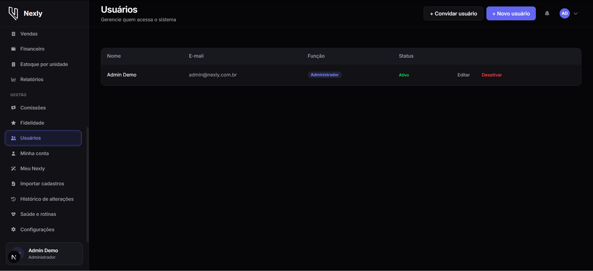</a>
</td>
</tr>
</table>

</details>

<details>
<summary><strong>Site institucional e acesso · 5 telas</strong></summary>

<table>
<tr>
<td width="50%" valign="top"><h4>Página inicial</h4>
<a href="docs/Screenshots/nexly-pagina_inicial.png">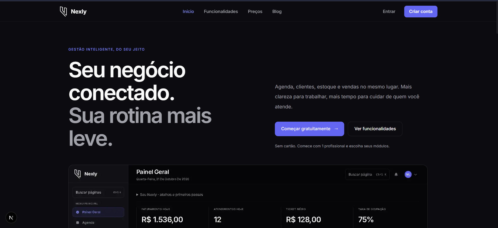</a>
</td>
<td width="50%" valign="top"><h4>Funcionalidades</h4>
<a href="docs/Screenshots/nexly-funcionalidades.png">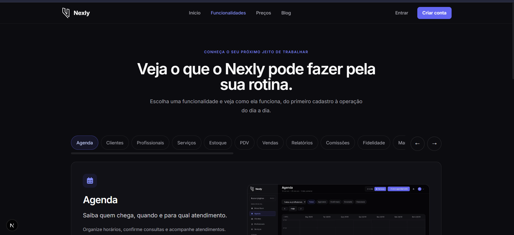</a>
</td>
</tr>
<tr>
<td width="50%" valign="top"><h4>Planos e preços</h4>
<a href="docs/Screenshots/nexly-preco.png">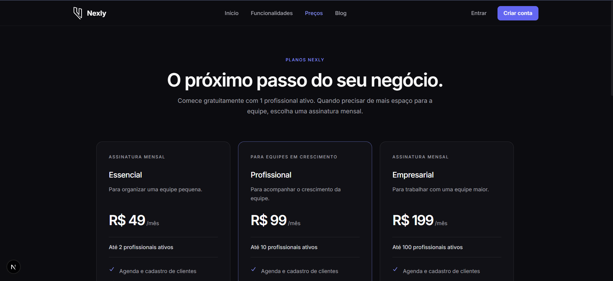</a>
</td>
<td width="50%" valign="top"><h4>Blog</h4>
<a href="docs/Screenshots/nexly-blog.png">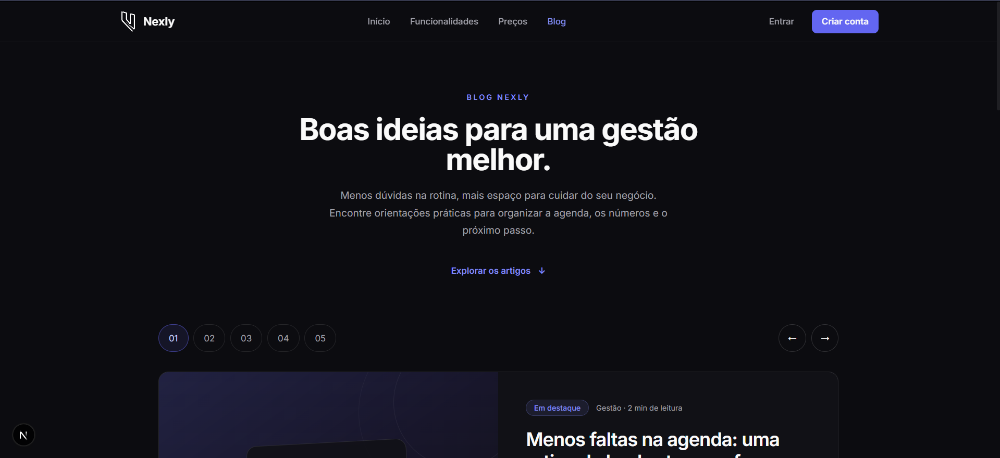</a>
</td>
</tr>
<tr>
<td width="50%" valign="top"><h4>Login e cadastro</h4>
<a href="docs/Screenshots/nexly-login_e_cadastro.png">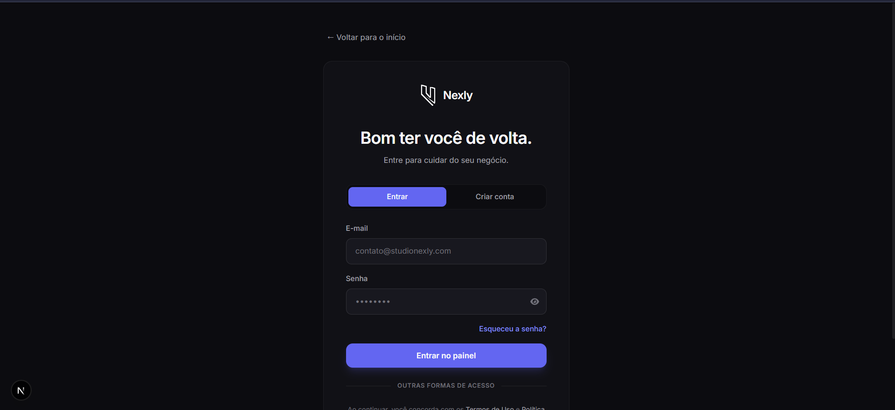</a>
</td>
</tr>
</table>

</details>

[Voltar ao topo](#topo)

---

<a id="site"></a>

## 5. Site e experiência pública

<div align="center">

<a href="https://nexly-web.vercel.app"></a>
<a href="https://nexly-web.vercel.app/funcionalidades"></a>
<a href="https://nexly-web.vercel.app/precos"></a>

</div>

| Página                                                                                                  | Finalidade                                        |
| ------------------------------------------------------------------------------------------------------- | ------------------------------------------------- |
| [Início](https://nexly-web.vercel.app)                                                                  | Produto, segmentos e conexão entre os módulos.    |
| [Funcionalidades](https://nexly-web.vercel.app/funcionalidades)                                         | Recursos e seus passos de uso.                    |
| [Preços](https://nexly-web.vercel.app/precos)                                                           | Planos e limites de profissionais.                |
| [Blog](https://nexly-web.vercel.app/blog)                                                               | Artigos, categorias e conteúdos de gestão.        |
| [Entrar](https://nexly-web.vercel.app/login)                                                            | Acesso a uma conta existente.                     |
| [Criar conta](https://nexly-web.vercel.app/cadastro)                                                    | Configuração de conta e negócio em quatro etapas. |
| [Suporte](https://nexly-web.vercel.app/suporte)                                                         | Orientações e contato de atendimento.             |
| [Termos](https://nexly-web.vercel.app/termos) e [privacidade](https://nexly-web.vercel.app/privacidade) | Informações publicadas sobre uso e dados.         |

O cadastro considera conta e empresa, segmento, recursos e aceite das condições. A configuração pode ser revista em Meu Nexly. Web e API são publicadas separadamente; o link do site não comprova disponibilidade contínua de todas as dependências.

[Voltar ao topo](#topo)

---

<a id="figma"></a>

## 6. Figma e identidade visual

<div align="center">

<a href="https://www.figma.com/design/nZXYARpSTmoeK3Gg7P0apb/Nexly?node-id=0-1"></a>
<a href="capturas/video_figma.mp4"></a>

</div>

A prototipação orientou a navegação, os componentes e a identidade visual. A aplicação utiliza **Inter**, superfícies escuras e índigo nos destaques, com adaptações para computador e celular.

| Elemento                | Referência                                                       |
| ----------------------- | ---------------------------------------------------------------- |
| Tipografia da interface | Inter.                                                           |
| Fundo principal         | `#060608`.                                                       |
| Superfícies             | `#111116` e `#18181F`.                                           |
| Texto principal         | `#FAFAFA`.                                                       |
| Destaques e ações       | `#6366F1`.                                                       |
| Composição              | Navegação lateral no desktop e componentes adaptados ao celular. |

<details>
<summary><strong>Ver as referências históricas de prototipação</strong></summary>

Estas imagens foram preservadas como registro da etapa de design. Podem apresentar nomes, valores e estruturas anteriores. As capturas atuais estão no tour visual.

<table>
  <tr>
    <td width="50%"><a href="capturas/captura1.png"></a><p align="center">Apresentação inicial do protótipo</p></td>
    <td width="50%"><a href="capturas/capturas2.png"></a><p align="center">Funcionalidades no protótipo</p></td>
  </tr>
  <tr>
    <td width="50%"><a href="capturas/capturas3.png">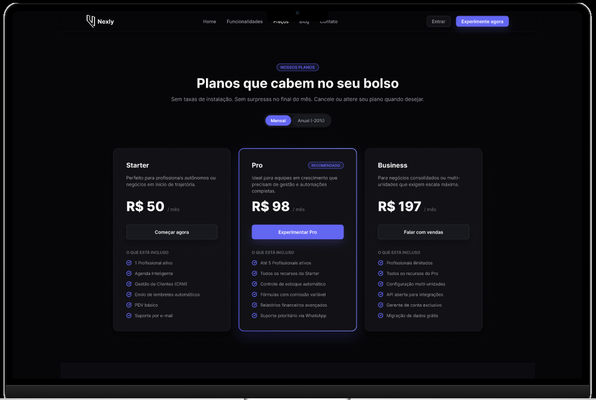</a><p align="center">Estudo de planos — valores históricos</p></td>
    <td width="50%"><a href="capturas/capturas4.png">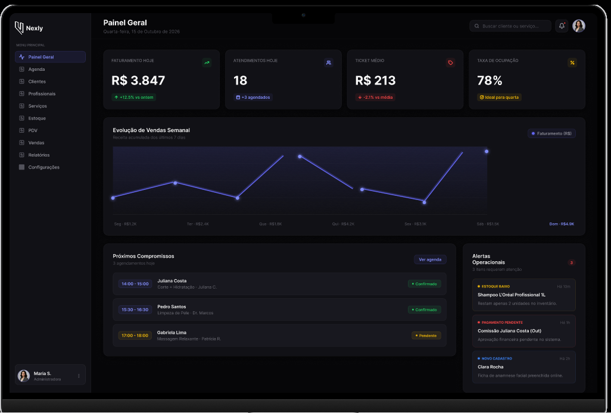</a><p align="center">Estudo do painel</p></td>
  </tr>
</table>

</details>

A manutenção considera rótulos, foco, teclado, carregamento, mensagens de erro e preferência por movimento reduzido. Essas práticas não equivalem a certificação formal de acessibilidade.

[Voltar ao topo](#topo)

---

<a id="planos"></a>

## 7. Planos e assinaturas

Os valores abaixo correspondem ao catálogo documentado nesta revisão. O pacote compartilhado define os limites de profissionais e o backend mantém as regras de cobrança.

| Plano            | Código       | Mensalidade | Profissionais ativos por empresa |
| ---------------- | ------------ | ----------- | -------------------------------- |
| **Gratuito**     | `FREE`       | **R$ 0**    | 1                                |
| **Essencial**    | `BASIC`      | **R$ 49**   | 2                                |
| **Profissional** | `PRO`        | **R$ 99**   | 10                               |
| **Empresarial**  | `ENTERPRISE` | **R$ 199**  | 100                              |

A cota é compartilhada entre unidades. Profissionais cadastrados são distintos de contas de login e acessos simultâneos. Selecionar um plano na interface não confirma pagamento nem concede acesso pago.

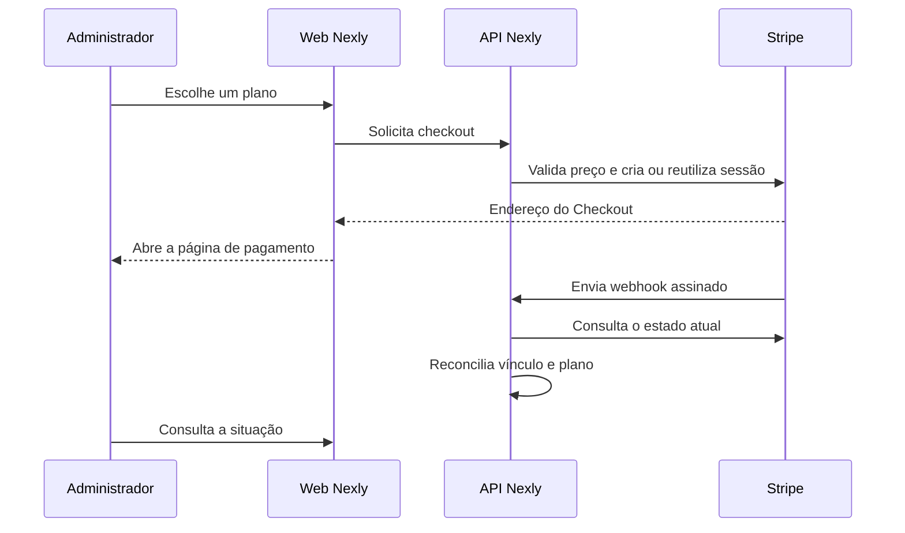

- O Stripe processa a **assinatura do Nexly**; vendas dos estabelecimentos no PDV têm outro propósito.
- Checkout e Customer Portal dependem do ambiente e do perfil autorizado.
- O retorno do checkout não comprova pagamento: webhook e reconciliação consultam o provedor.
- Há reconciliação agendada por empresa e ambiente, com fila persistida e deduplicação.
- `test` registra homologação sem alterar o plano comercial de produção. A mudança comercial ocorre no fluxo `live` com as condições exigidas.

[Limites compartilhados](packages/shared/src/plans.ts) · [Guia de pagamentos](docs/PAGAMENTOS.md) · [Módulo de assinaturas](apps/api/src/assinaturas)

[Voltar ao topo](#topo)

---

<a id="arquitetura"></a>

## 8. Arquitetura e caminho dos dados

O **monorepositório** reúne interface, API e pacotes compartilhados. npm Workspaces gerencia os pacotes; Turborepo organiza as tarefas.

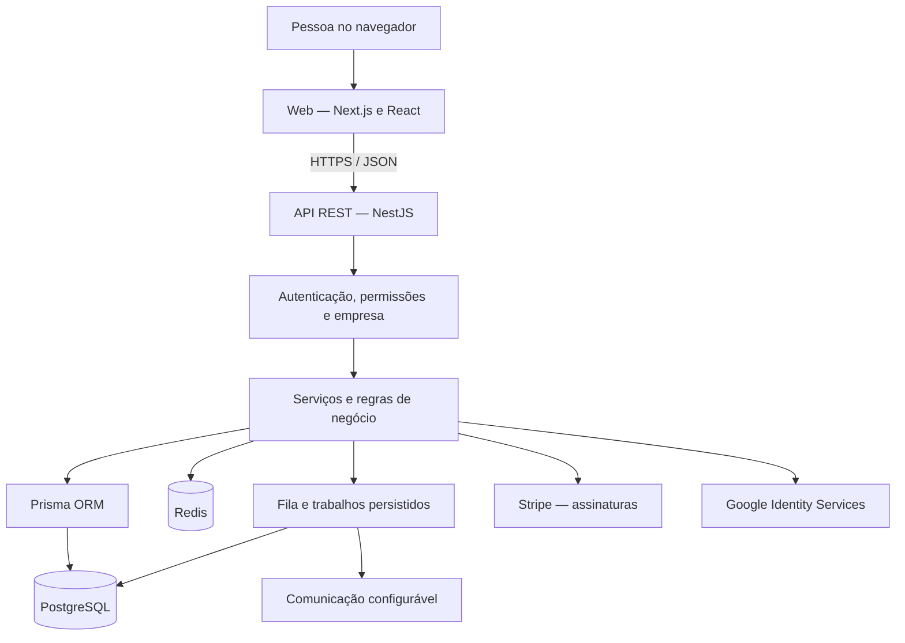

| Camada              | Responsabilidade                                      |
| ------------------- | ----------------------------------------------------- |
| Web                 | Páginas, navegação, formulários, gráficos e retornos. |
| Controllers e DTOs  | Rotas, parâmetros, entrada e contratos HTTP.          |
| Guards e contexto   | Sessão, papel, permissão e empresa autorizada.        |
| Services            | Regras, transações e integrações.                     |
| Prisma e PostgreSQL | Registros, relações e integridade.                    |
| Redis               | Cache, cotas distribuídas e estados temporários.      |
| Jobs persistidos    | Tentativas, processamento e recuperação de trabalhos. |
| Shared              | Tipos, papéis, permissões, módulos e limites comuns.  |

**Uma requisição, passo a passo:** a interface solicita uma ação; o cliente HTTP chama a API; guards e validações conferem identidade, entrada e empresa; o serviço consulta ou altera os dados; a resposta JSON se transforma em resultado ou orientação na tela.

Interceptors complementam o fluxo com auditoria, logs e invalidação de cache. O Redis é auxiliar e não fica obrigatoriamente entre toda consulta e o PostgreSQL.

[Arquitetura](docs/ARQUITETURA.md) · [Módulo principal](apps/api/src/app.module.ts) · [Cliente HTTP](apps/web/src/lib/api.ts)

[Voltar ao topo](#topo)

---

<a id="stack"></a>

## 9. Stack tecnológica

As versões representam os manifests atuais. O lockfile registra as resoluções exatas e transitivas.

| Área               | Tecnologias                                      | Papel                             |
| ------------------ | ------------------------------------------------ | --------------------------------- |
| Runtime            | Node.js 24, faixa `>=24.22.1 <25`                | API e ferramentas.                |
| Interface          | Next.js 16.4.1, React 19, TypeScript             | Páginas e componentes tipados.    |
| Estilo             | Tailwind CSS 3, Inter, Font Awesome              | Layout, identidade e ícones.      |
| Interação          | Framer Motion, Sonner                            | Movimento e retornos.             |
| Formulários        | React Hook Form, Zod 4                           | Estado e validação.               |
| Comunicação        | Axios                                            | Requisições e respostas.          |
| Gráficos           | Recharts                                         | Indicadores.                      |
| Conteúdo e leitura | MDX, YAML, ZXing                                 | Artigos e códigos de barras.      |
| Backend            | NestJS 12.1.3, Express, TypeScript               | API e domínio.                    |
| Validação da API   | Class Validator, Class Transformer               | DTOs e entrada.                   |
| Persistência       | Prisma 5.22, PostgreSQL                          | Schema, migrações e dados.        |
| Cache              | Redis, ioredis                                   | Estados e controles distribuídos. |
| Identidade         | Argon2id, JWT RS256, otplib, Google Auth Library | Senha, sessão, 2FA e Google.      |
| Cobrança do SaaS   | Stripe                                           | Assinatura e portal.              |
| Datas              | date-fns, date-fns-tz                            | Períodos e fusos.                 |
| Monorepositório    | npm Workspaces, Turborepo                        | Pacotes e tarefas.                |
| Qualidade          | Jest, Playwright, ESLint, Prettier               | Testes e verificações.            |
| Entrega            | Docker, Compose, GitHub Actions                  | Serviços, imagens e CI.           |

O projeto declara **npm 11.16.0**. A API utiliza TypeScript 6 e web/shared têm configurações próprias; execute os scripts no workspace correspondente.

[Manifest da raiz](package.json) · [Web](apps/web/package.json) · [API](apps/api/package.json)

[Voltar ao topo](#topo)

---

<a id="dados"></a>

## 10. Banco de dados, MER e DER

O schema contém **41 modelos e sete enumerações**. PostgreSQL armazena os dados permanentes; Redis atende estados temporários. [`schema.prisma`](apps/api/prisma/schema.prisma) e as [migrações](apps/api/prisma/migrations) são as referências executáveis.

### Como ler a modelagem

- **Entidade/modelo:** tipo de registro, como cliente ou produto.
- **Chave primária (PK):** identifica um registro.
- **Chave estrangeira (FK):** relaciona um registro a outro.
- **Cardinalidade:** quantas ocorrências participam de uma relação.
- **Transação:** confirma operações relacionadas em conjunto ou desfaz suas alterações em caso de falha.

### MER — núcleo conceitual

O MER apresenta as entidades centrais sem listar todos os campos.

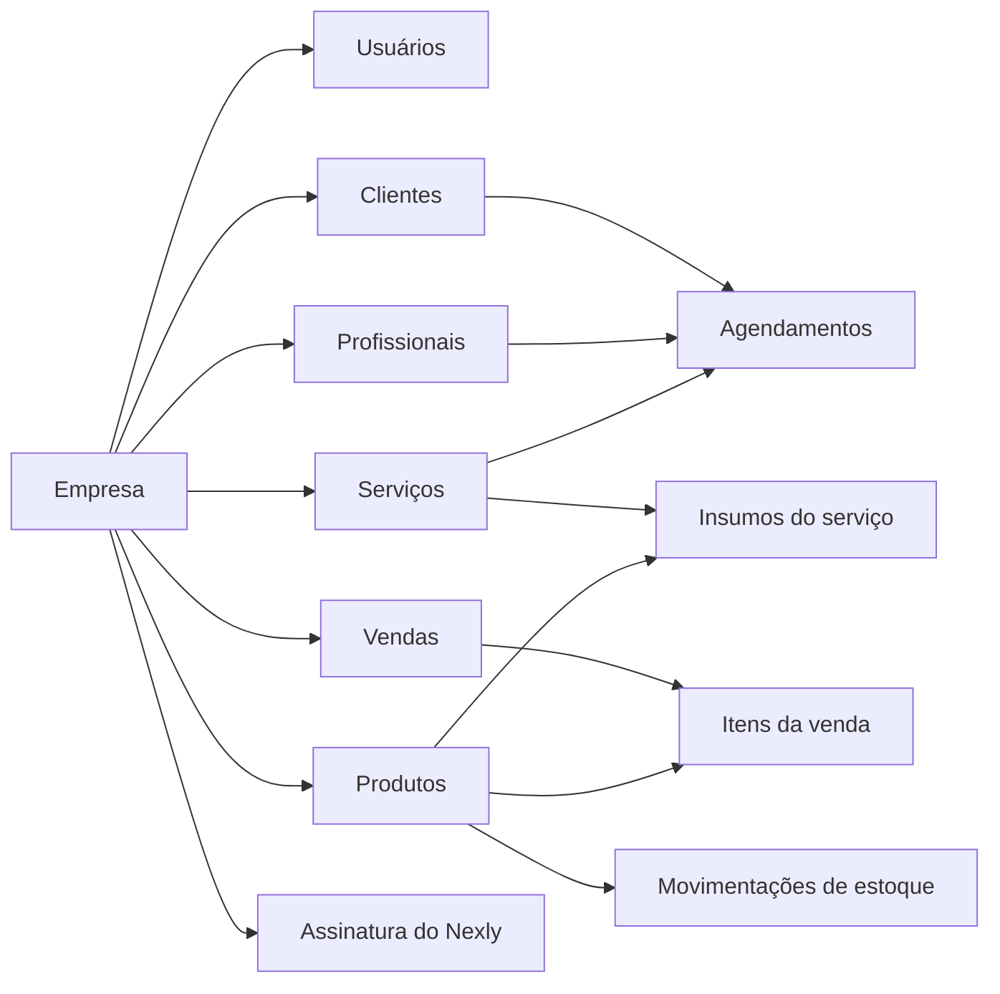

<details>
<summary><strong>DER — abrir o recorte lógico dos principais modelos</strong></summary>

Este recorte não substitui o inventário completo. Os nomes correspondem aos modelos Prisma; campos, índices e relações complementares foram omitidos para facilitar a leitura.

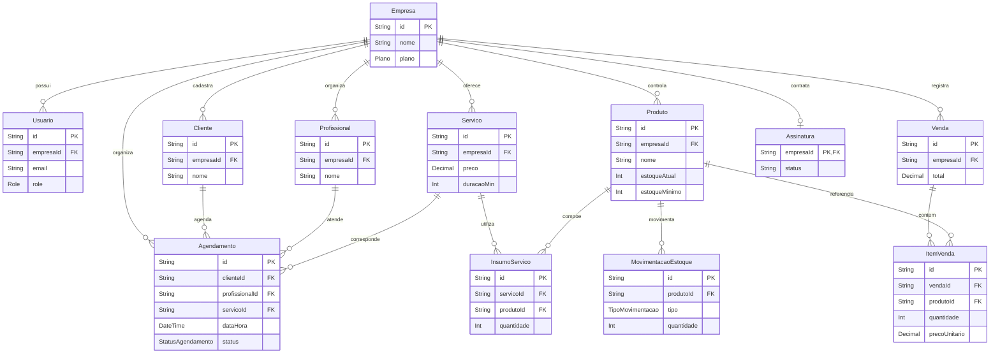

</details>

### Famílias de dados

| Domínio                           | Exemplos                                                                                               |
| --------------------------------- | ------------------------------------------------------------------------------------------------------ |
| Empresa e acesso                  | `Empresa`, `Usuario`, `AuthSession`, `RefreshToken`, `ConviteUsuario`.                                 |
| Atendimento                       | `Cliente`, `Profissional`, `Servico`, `InsumoServico`, `Agendamento`.                                  |
| Produtos e vendas                 | `Produto`, `MovimentacaoEstoque`, `Venda`, `ItemVenda`, `Cupom`.                                       |
| Compras e unidades                | `Fornecedor`, `PedidoCompra`, `ItemPedidoCompra`, `Filial`, `SaldoFilial`, `TransferenciaFilial`.      |
| Financeiro                        | `LancamentoFinanceiro`, `BaixaFinanceira`.                                                             |
| Operação e relacionamento         | `Tarefa`, `Documento`, `Campanha`, `ConsentimentoMarketing`, `Automacao`, `Recorrencia`, `JobDuravel`. |
| Cobrança, auditoria e privacidade | `Assinatura`, `EventoStripe`, `AuditLog`, `TermoAceite`, `ExclusaoConta`, `RecuperacaoSenha`.          |

`InsumoServico` resolve a associação entre serviço e produto. Itens de venda mantêm quantidade e preço da operação. O escopo de empresa pode estar no registro ou ser obtido por relações com o pai; a autorização precisa considerar ambos.

[Modelo completo](docs/MODELO_DADOS.md) · [Contexto de empresa](apps/api/src/database/tenant-context.ts) · [Escopo dos dados](apps/api/src/database/tenant-scope.ts)

[Voltar ao topo](#topo)

---

<a id="api"></a>

## 11. API REST e contratos

A API usa o prefixo **`/api`** e responde em JSON. A referência gerada registra **195 declarações de rota** nesta revisão. Swagger está disponível em desenvolvimento em [`http://localhost:3001/api/docs`](http://localhost:3001/api/docs).

<div align="center">

<a href="docs/REFERENCIA_API.md"></a>
<a href="http://localhost:3001/api/docs"></a>

</div>

### Rotas para começar

| Método                 | Rota                           | Finalidade                                            |
| ---------------------- | ------------------------------ | ----------------------------------------------------- |
| `POST`                 | `/api/auth/register`           | Criar conta e negócio pelo cadastro.                  |
| `POST`                 | `/api/auth/login`              | Autenticar com e-mail e senha.                        |
| `POST`                 | `/api/auth/refresh`            | Renovar a sessão.                                     |
| `POST`                 | `/api/auth/logout`             | Encerrar o acesso.                                    |
| `GET`                  | `/api/auth/me`                 | Consultar o usuário autenticado.                      |
| `GET`                  | `/api/auth/sessions`           | Consultar sessões da conta.                           |
| `GET`                  | `/api/auth/google/config`      | Consultar a disponibilidade do Google.                |
| `GET`                  | `/api/dashboard`               | Consultar indicadores permitidos para o perfil.       |
| `GET`                  | `/api/dashboard/alertas`       | Consultar alertas do negócio.                         |
| `GET`, `POST`          | `/api/clientes`                | Listar ou cadastrar clientes.                         |
| `GET`, `PUT`, `DELETE` | `/api/clientes/:id`            | Consultar, atualizar ou desativar um cliente.         |
| `GET`, `POST`          | `/api/profissionais`           | Listar ou cadastrar profissionais.                    |
| `GET`, `POST`          | `/api/servicos`                | Listar ou cadastrar serviços.                         |
| `POST`                 | `/api/servicos/:id/insumos`    | Associar insumos ao serviço.                          |
| `GET`, `POST`          | `/api/agendamentos`            | Consultar ou criar agendamentos.                      |
| `PATCH`                | `/api/agendamentos/:id/status` | Alterar o estado do atendimento.                      |
| `GET`, `POST`          | `/api/produtos`                | Consultar ou cadastrar produtos.                      |
| `POST`                 | `/api/estoque/entrada`         | Registrar entrada de estoque.                         |
| `GET`, `POST`          | `/api/vendas`                  | Consultar ou registrar vendas.                        |
| `POST`                 | `/api/vendas/:id/estornar`     | Estornar uma venda conforme as regras.                |
| `GET`, `POST`          | `/api/gestao/financeiro`       | Consultar ou registrar contas.                        |
| `GET`                  | `/api/booking/:token/horarios` | Consultar horários de um link público.                |
| `POST`                 | `/api/booking/:token/agendar`  | Solicitar agendamento público.                        |
| `GET`                  | `/api/assinaturas`             | Consultar situação e disponibilidade da assinatura.   |
| `POST`                 | `/api/assinaturas/checkout`    | Criar ou reutilizar um Checkout autorizado.           |
| `POST`                 | `/api/assinaturas/portal`      | Criar acesso ao Customer Portal.                      |
| `POST`                 | `/api/assinaturas/webhook`     | Receber eventos Stripe com assinatura validada.       |
| `GET`                  | `/api/health`                  | Verificar se a API responde.                          |
| `GET`                  | `/api/health/deep`             | Conferir PostgreSQL e Redis.                          |
| `GET`                  | `/api/health/version`          | Consultar versão, runtime e commit quando disponível. |

A tabela é uma seleção. DTOs, guards e services definem campos, papéis e regras completas.

### Exemplo de diagnóstico

Com a API local iniciada:

```bash
curl http://localhost:3001/api/health/deep
```

Recorte de uma resposta saudável; os campos operacionais variam entre execuções:

```json
{
  "status": "ok",
  "api": "ok",
  "db": "ok",
  "redis": "ok"
}
```

Rotas protegidas recebem o access token pelo cabeçalho `Authorization: Bearer <token>`. A web mantém esse token em memória e usa o fluxo de refresh para renovar o acesso.

| Status | Leitura prática                                                  |
| ------ | ---------------------------------------------------------------- |
| `400`  | Confira campos e parâmetros.                                     |
| `401`  | A autenticação está ausente, inválida ou precisa ser renovada.   |
| `403`  | O usuário não tem acesso à ação.                                 |
| `409`  | Há conflito de estado, concorrência ou regra de negócio.         |
| `429`  | O limite de requisições foi atingido.                            |
| `5xx`  | Falha do servidor ou de uma dependência; consulte o diagnóstico. |

[Voltar ao topo](#topo)

---

<a id="acesso"></a>

## 12. Autenticação e permissões

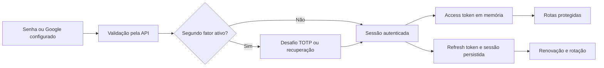

O backend implementa senha com Argon2id, JWT RS256, sessões persistidas, renovação, revogação e segundo fator. Google utiliza **Google Identity Services** com validação de ID token, sem copiar o fluxo de callback de outro projeto.

| Papel           | Responsabilidade típica                                                 |
| --------------- | ----------------------------------------------------------------------- |
| `ADMIN`         | Administração da empresa e ações administrativas, inclusive assinatura. |
| `GESTOR`        | Gestão operacional dos recursos autorizados.                            |
| `PROFISSIONAL`  | Consulta de agenda, painel e notificações permitidas.                   |
| `RECEPCIONISTA` | Agenda, clientes e consultas de apoio ao atendimento.                   |
| `CAIXA`         | Vendas e consultas de estoque, clientes e apoio ao caixa.               |

O resumo não substitui a política exata em [`permissions.ts`](packages/shared/src/permissions.ts), os guards e as regras da API. Esconder uma ação no menu não substitui autorização no servidor.

[Voltar ao topo](#topo)

---

<a id="seguranca"></a>

## 13. Segurança, privacidade e integridade

| Camada           | Medidas implementadas                                                                        |
| ---------------- | -------------------------------------------------------------------------------------------- |
| Senhas           | Hash Argon2id.                                                                               |
| Tokens e sessões | JWT RS256, expiração, refresh, persistência e revogação.                                     |
| Segundo fator    | TOTP, recuperação e controles contra repetição.                                              |
| Navegador        | Cabeçalhos de proteção, origens CORS configuradas e cookies conforme ambiente.               |
| Entrada da API   | DTOs, validação, limites de corpo e rejeição de corpos comprimidos nos parsers configurados. |
| Perfis           | Guards e permissões por papel.                                                               |
| Multiempresa     | Contexto, filtros, validação de vínculos e políticas do banco onde configuradas.             |
| Concorrência     | Transações, travas e idempotência nos fluxos que exigem coordenação.                         |
| Auditoria        | Alterações e contexto das operações.                                                         |
| Segredos         | Exemplos sem credenciais reais e chaves fora do Git.                                         |
| Privacidade      | Fluxos de dados e exclusão, com dependências operacionais documentadas.                      |
| Continuidade     | Scripts de backup cifrado e restauração, sujeitos à configuração externa.                    |

Não use credenciais de produção em seeds ou campanhas locais. Não coloque segredos em `NEXT_PUBLIC_*`. Confira o papel efetivo da conexão PostgreSQL ao avaliar RLS e teste recuperação e restauração com evidências próprias.

Esses controles não constituem certificação de segurança, garantia de ausência de vulnerabilidades ou declaração de conformidade legal integral. Avisos e resultados documentados têm data e escopo.

[Segurança](docs/SEGURANCA.md) · [Operação](docs/OPERACAO.md) · [Testes](docs/TESTES.md)

[Voltar ao topo](#topo)

---

<a id="integracoes"></a>

## 14. Integrações e relação com o NexusAuth

| Integração               | Uso                                         | Configuração necessária                                      |
| ------------------------ | ------------------------------------------- | ------------------------------------------------------------ |
| Google Identity Services | Entrada e vínculo Google.                   | Cliente Web, origens autorizadas e client ID.                |
| Stripe                   | Assinaturas do Nexly.                       | Ambiente, catálogo, chave, webhook e portal.                 |
| E-mail / Resend          | Recuperação e comunicação disponível.       | Provedor, remetente, chave, URL pública e cifra da fila.     |
| WhatsApp                 | Comunicação conforme provedor.              | Provedor e credenciais; campanhas manuais têm fluxo próprio. |
| PostgreSQL / Supabase    | Persistência relacional.                    | Conexões e privilégios.                                      |
| Redis                    | Cache e controles temporários/distribuídos. | URL e disponibilidade.                                       |
| NexusAuth                | Ponte opcional para serviço complementar.   | URL e chave próprias, quando utilizado.                      |

### Nexly e NexusAuth são partes distintas

A autenticação do Nexly está em [`apps/api/src/auth`](apps/api/src/auth). [`services/nexusauth`](services/nexusauth) contém um serviço complementar com dependências próprias, fora dos workspaces `apps/*` e `packages/*`.

A presença desse diretório não habilita automaticamente SSO, Magic Link, GitHub OAuth, JWKS, Prometheus ou outros recursos do NexusAuth para os usuários do Nexly. Cada capacidade precisa ser conferida no fluxo e na configuração do produto que a utiliza.

[README do NexusAuth](services/nexusauth/README.md) · [Pagamentos](docs/PAGAMENTOS.md) · [Integrações e operação](docs/OPERACAO.md)

[Voltar ao topo](#topo)

---

<a id="estrutura"></a>

## 15. Estrutura do repositório

```text
Nexly/
├── apps/
│   ├── web/                       # Interface Next.js
│   │   ├── src/app/               # Rotas públicas, acesso e gestão
│   │   ├── src/components/        # Componentes de produto e apresentação
│   │   ├── src/lib/               # API, sessão e utilitários
│   │   ├── public/                # Marca e imagens
│   │   └── content/               # Blog
│   └── api/                       # API NestJS
│       ├── src/auth/              # Autenticação e sessões
│       ├── src/database/          # Prisma e contexto de empresa
│       ├── src/agendamentos/      # Atendimento e agenda
│       ├── src/estoque/           # Movimentações e consumo
│       ├── src/vendas/            # Vendas e regras do PDV
│       ├── src/assinaturas/       # Cobrança do SaaS
│       ├── src/jobs/              # Processamento persistido
│       ├── prisma/                # Schema, migrações e seed
│       └── test/                  # Configuração e apoio aos testes
├── packages/
│   ├── shared/                    # Tipos, permissões, módulos e limites
│   └── tsconfig/                  # Configurações TypeScript
├── services/nexusauth/            # Serviço complementar independente
├── docs/
│   ├── README.md                  # Índice dos guias
│   ├── Screenshots/               # 32 capturas atuais
│   └── documentacao/              # Word, plano GOT e checklist
├── capturas/                      # Referências históricas do protótipo
├── e2e/                           # Navegador e utilitários
├── scripts/                       # Operação e verificações
├── .github/workflows/             # CI, segurança e backup
├── docker-compose.yml            # Serviços de desenvolvimento
├── docker-compose.dev.yml        # Ajustes de desenvolvimento
├── turbo.json                     # Tarefas do monorepositório
├── package.json                   # Workspaces e scripts
└── README.md
```

`node_modules`, `.next`, `dist`, `test-results` e arquivos `.env` são gerados/configurados localmente e não compõem o código de referência para publicação.

[Voltar ao topo](#topo)

---

<a id="instalacao"></a>

## 16. Instalação e execução local

### Pré-requisitos

| Requisito          | Referência                                                             |
| ------------------ | ---------------------------------------------------------------------- |
| Git                | Clonar e acompanhar alterações.                                        |
| Node.js            | **24.22.1** em `.nvmrc`; faixa `>=24.22.1 <25`.                        |
| npm                | O projeto declara **11.16.0**.                                         |
| PostgreSQL e Redis | Locais; Compose fornece PostgreSQL 16 e Redis 7.                       |
| Portas             | `3002` web, `3001` API, `5432` PostgreSQL e `6379` Redis nos exemplos. |

O código verifica Node na instalação, no desenvolvimento, no build e no iniciador local.

### 1. Obter o projeto e instalar

```bash
git clone https://github.com/Breno-J-Oliveira/Nexly.git
cd Nexly
npm ci
```

### 2. Criar as configurações

Copie somente quando o destino não existir, preservando os ambientes já preparados.

<details>
<summary><strong>Linux, macOS ou Git Bash</strong></summary>

```bash
cp -n .env.example .env
cp -n apps/api/.env.example apps/api/.env
cp -n apps/web/.env.example apps/web/.env
```

</details>

<details>
<summary><strong>Windows com PowerShell</strong></summary>

```powershell
if (-not (Test-Path .env)) { Copy-Item .env.example .env }
if (-not (Test-Path apps/api/.env)) { Copy-Item apps/api/.env.example apps/api/.env }
if (-not (Test-Path apps/web/.env)) { Copy-Item apps/web/.env.example apps/web/.env }
```

Se a máquina bloquear `npm.ps1`, utilize `npm.cmd`, sem alterar a política global.

</details>

Revise as conexões da API e o endereço do backend na web. Os exemplos usam credenciais públicas de desenvolvimento, que não devem ser reutilizadas em produção.

### 3. Iniciar PostgreSQL e Redis

```bash
docker compose up -d postgres redis
```

É possível usar instalações nativas e ajustar as URLs. Esse comando inicia somente as dependências; a API e a interface serão executadas com npm.

### 4. Preparar o compartilhado e o banco

```bash
npm run build --workspace @nexly/shared
npx prisma generate --schema apps/api/prisma/schema.prisma
npm run db:migrate --workspace @nexly/api
```

Na API, `db:migrate` aplica migrações existentes. Para criar uma durante desenvolvimento, use `npm run db:migrate:dev --workspace @nexly/api`. O script `db:migrate` da raiz tem finalidade de desenvolvimento diferente; confira o workspace ao executar.

### 5. Iniciar a aplicação

```bash
npm run dev
```

O Turborepo inicia os processos de desenvolvimento dos workspaces.

| Recurso       | Endereço local                                                                 |
| ------------- | ------------------------------------------------------------------------------ |
| Interface     | [http://localhost:3002](http://localhost:3002)                                 |
| Login         | [http://localhost:3002/login](http://localhost:3002/login)                     |
| Saúde básica  | [http://localhost:3001/api/health](http://localhost:3001/api/health)           |
| Banco e Redis | [http://localhost:3001/api/health/deep](http://localhost:3001/api/health/deep) |
| Swagger       | [http://localhost:3001/api/docs](http://localhost:3001/api/docs)               |

### 6. Opcional: carregar a demonstração

Somente em **banco local descartável**, sem dados de clientes reais:

```bash
npm run db:seed
```

| Campo   | Conta demonstrativa local                                                             |
| ------- | ------------------------------------------------------------------------------------- |
| E-mail  | `admin@nexly.com.br`                                                                  |
| Senha   | `nexly123`                                                                            |
| Cenário | Empresa fictícia, clientes, profissionais, serviços, produtos e registros de exemplo. |

Essa é uma conta do seed, não uma credencial de administração do site publicado.

### Iniciador opcional para Windows

Após instalar dependências, criar `.env` e iniciar banco/Redis:

```powershell
powershell.exe -NoProfile -ExecutionPolicy Bypass -File scripts/start-local.ps1
```

O parâmetro aplica-se só a esse processo. O script verifica Node, conexões e portas, aplica migrações, compila e inicia os processos com logs no diretório temporário `nexly-local`. Preserva processos que já ocupam as portas e mantém comunicação externa desativada na execução local. Não instala os serviços de banco/cache.

[Guia de desenvolvimento](docs/DESENVOLVIMENTO.md)

[Voltar ao topo](#topo)

---

<a id="ambiente"></a>

## 17. Variáveis de ambiente

| Arquivo                                                            | Uso                                   |
| ------------------------------------------------------------------ | ------------------------------------- |
| [`.env.example`](.env.example) → `.env`                            | Compose e comandos da raiz.           |
| [`apps/api/.env.example`](apps/api/.env.example) → `apps/api/.env` | Conexões, autenticação e integrações. |
| [`apps/web/.env.example`](apps/web/.env.example) → `apps/web/.env` | Endereços públicos da interface.      |

### Configuração essencial

| Variável                                                             | Onde    | Finalidade                                                         |
| -------------------------------------------------------------------- | ------- | ------------------------------------------------------------------ |
| `DATABASE_URL`                                                       | API     | Conexão Prisma.                                                    |
| `DIRECT_URL`                                                         | API     | Conexão de migração; pode coincidir com o banco local.             |
| `REDIS_URL`                                                          | API     | Endereço Redis.                                                    |
| `PORT`                                                               | API     | Porta HTTP; exemplo `3001`.                                        |
| `CORS_ORIGIN`                                                        | API     | Origens autorizadas; exemplo `http://localhost:3002`.              |
| `JWT_PRIVATE_KEY`, `JWT_PUBLIC_KEY`                                  | API     | Par RSA.                                                           |
| `JWT_ACCESS_TTL`, `JWT_REFRESH_TTL`                                  | API     | Duração dos tokens; exemplos `15m` e `7d`.                         |
| `NEXT_PUBLIC_API_URL`                                                | Web     | Origem da API, como `http://localhost:3001`, sem `/api` no padrão. |
| `NEXT_PUBLIC_SITE_URL`                                               | Web     | Endereço da interface.                                             |
| `POSTGRES_USER`, `POSTGRES_PASSWORD`, `POSTGRES_DB`, `POSTGRES_PORT` | Compose | Banco local.                                                       |
| `REDIS_PORT`, `API_PORT`, `WEB_PORT`                                 | Compose | Portas publicadas.                                                 |

### Configuração opcional

| Integração  | Variáveis principais                                                                                       |
| ----------- | ---------------------------------------------------------------------------------------------------------- |
| Google      | `GOOGLE_CLIENT_ID`.                                                                                        |
| Stripe test | `STRIPE_ENABLED`, `STRIPE_MODE`, `STRIPE_RESTRICTED_KEY`, `STRIPE_WEBHOOK_SECRET`, `STRIPE_RETURN_ORIGIN`. |
| Stripe live | `STRIPE_LIVE_RESTRICTED_KEY`, `STRIPE_LIVE_WEBHOOK_SECRET` e condições de produção.                        |
| E-mail      | `EMAIL_PROVIDER`, `RESEND_API_KEY`, `EMAIL_FROM`, `PUBLIC_APP_URL`, `EMAIL_QUEUE_KEY`.                     |
| WhatsApp    | `WHATSAPP_PROVIDER` e parâmetros do provedor.                                                              |
| NexusAuth   | `NEXUSAUTH_URL`, `NEXUSAUTH_API_KEY`.                                                                      |
| Cookies     | `COOKIE_DOMAIN`, quando necessário para a topologia.                                                       |

Em desenvolvimento, a API pode gerar chaves temporárias quando não há JWT configurado; reiniciar afeta a continuidade dos tokens. Em produção, prepare as chaves exigidas; consulte [`generate-jwt-keys.sh`](scripts/generate-jwt-keys.sh).

`NEXT_PUBLIC_*` é público. Senhas, banco, chaves e segredos de webhook devem permanecer no backend.

[Voltar ao topo](#topo)

---

<a id="comandos"></a>

## 18. Comandos úteis

Execute da raiz, exceto quando indicado. A existência de um script não representa aprovação automática da sua execução.

| Comando                                          | Finalidade                                 |
| ------------------------------------------------ | ------------------------------------------ |
| `npm ci`                                         | Instalar pelo lockfile.                    |
| `npm run dev`                                    | Desenvolvimento dos workspaces.            |
| `npm run build`                                  | Compilar pelo Turborepo.                   |
| `npm run build --workspace @nexly/shared`        | Preparar o compartilhado.                  |
| `npm run typecheck --workspace @nexly/api`       | Tipos da API.                              |
| `npm run typecheck --workspace @nexly/web`       | Tipos de rotas e da web.                   |
| `npm run typecheck:e2e`                          | Tipos dos testes.                          |
| `npm run lint`                                   | Estilo/código dos workspaces.              |
| `npm run format:check`                           | Formatação Prettier.                       |
| `npm test --workspace @nexly/api -- --runInBand` | Testes da API em sequência.                |
| `npm run e2e`                                    | Playwright com ambiente preparado.         |
| `npm run e2e:ui`                                 | Interface de testes.                       |
| `npm run e2e:report`                             | Relatório HTML gerado.                     |
| `npm run db:migrate --workspace @nexly/api`      | Aplicar migrações existentes.              |
| `npm run db:migrate:dev --workspace @nexly/api`  | Criar/aplicar migração em desenvolvimento. |
| `npm run db:seed`                                | Demonstração em banco local descartável.   |
| `npm run db:studio`                              | Prisma Studio do banco configurado.        |
| `npm run docs:generate`                          | Inventários de rotas e modelos.            |
| `npm run docs:check`                             | Referências e links documentais.           |

[Voltar ao topo](#topo)

---

<a id="testes"></a>

## 19. Qualidade, testes e evidências

Os testes acompanham diferentes partes da solução. Testes unitários verificam regras isoladas; verificações com banco real exercitam persistência e permissões; testes de navegador reproduzem ações de uma pessoa na interface.

| Camada                  | Ferramenta ou abordagem           | Exemplos                                               |
| ----------------------- | --------------------------------- | ------------------------------------------------------ |
| Regras da API           | Jest                              | Serviços, validação, autorização e erros.              |
| Persistência e negócio  | Prisma + scripts de verificação   | Isolamento de empresas, transferências e idempotência. |
| Interface e jornadas    | Playwright                        | PDV, agenda, estoque, configurações e navegação.       |
| Responsividade          | Navegador com diferentes larguras | Transbordamento, diálogos e telas com nomes longos.    |
| Contratos estáticos     | TypeScript                        | API, web, pacote compartilhado e E2E.                  |
| Consistência documental | Gerador e verificador local       | Modelos, rotas e referências a arquivos.               |

### Executar as verificações

```bash
# Na raiz, com dependências instaladas
npm run build --workspace @nexly/shared
npm run typecheck
npm run typecheck:e2e
npm run lint
npm run test --workspace @nexly/api -- --runInBand
npm run docs:check

# Instalar o navegador de teste uma vez
npx playwright install chromium

# Com aplicação e dependências locais disponíveis
npm run e2e
npm run e2e:report
```

Leia [o guia de testes](docs/TESTES.md) e a configuração de cada cenário antes de executar verificações com banco. Use uma base própria de testes, com dados fictícios: cenários de integração criam e alteram registros. A instalação do navegador também exige espaço em disco.

### Registro da revisão local de 29/10/2026

| Campanha                                 | Resultado registrado                        | Alcance                                                     |
| ---------------------------------------- | ------------------------------------------- | ----------------------------------------------------------- |
| API                                      | **655 testes aprovados em 60 suítes**       | Suíte Jest executada localmente.                            |
| Regras comerciais com banco real         | **44 verificações aprovadas**               | Persistência, validação, perfis, isolamento e idempotência. |
| Seleção de navegador e utilitários       | **22 de 23 aprovados na primeira execução** | Um cenário foi interrompido por falta de espaço (`ENOSPC`). |
| Repetição do cenário interrompido        | **1 aprovado**                              | Varredura dos módulos em 320 px, diálogos e erros.          |
| Regressão do iniciador local             | **2 aprovados**                             | Aceitação e rejeição de versões do Node.js.                 |
| Páginas públicas após atualização visual | **3 aprovados**                             | Capturas atuais e apresentação em 390 e 1440 px.            |

Esses grupos têm escopos distintos e não formam um único total de testes. São evidências de execuções locais datadas; não representam homologação de todas as integrações externas ou de cada versão publicada. O badge de CI no início consulta o workflow do GitHub, separadamente desses registros.

Consulte [a revisão da apresentação](docs/documentacao/REVISAO_APRESENTACAO_2026-10-29.md), o [plano de testes e GOT](docs/documentacao/Nexly_Plano_de_Testes_e_GOT_ABNT.docx) e os [workflows](https://github.com/Breno-J-Oliveira/Nexly/actions) para detalhes. O registro da revisão preserva o estado observado naquele momento; atualizações posteriores de imagens são descritas neste README e nos arquivos atuais.

[Voltar ao topo](#topo)

---

<a id="operacao"></a>

## 20. CI, publicação e operação

### Automação no repositório

| Workflow  | Responsabilidade                                                                                      | Arquivo                                        |
| --------- | ----------------------------------------------------------------------------------------------------- | ---------------------------------------------- |
| CI        | Verificações de código, documentação, testes e imagens de contêiner conforme os jobs configurados.    | [ci.yml](.github/workflows/ci.yml)             |
| Segurança | Verificações automatizadas definidas para o repositório.                                              | [security.yml](.github/workflows/security.yml) |
| Backup    | Backup diário e teste semanal de restauração, dependentes dos secrets e do armazenamento configurado. | [backup.yml](.github/workflows/backup.yml)     |

### Topologia documentada

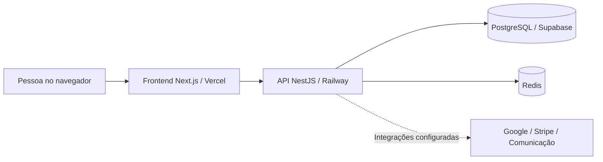

Esse desenho descreve a distribuição de responsabilidades prevista na documentação e nas configurações. Disponibilidade, credenciais e funcionamento do ambiente remoto precisam ser conferidos no ambiente publicado.

### Sequência de publicação

1. Executar instalação, build, verificações estáticas e testes aplicáveis com o Node.js suportado.
2. Provisionar PostgreSQL e Redis e definir as variáveis de cada aplicação.
3. Gerar o Prisma Client e aplicar as migrações existentes no banco de destino.
4. Publicar a API, conferir os logs e verificar o diagnóstico de saúde.
5. Publicar a web com `NEXT_PUBLIC_API_URL` apontando para a API correta; essa variável participa do build do frontend.
6. Ajustar CORS, URLs de retorno, domínios e chaves das integrações habilitadas.
7. Validar cadastro, login e uma jornada completa com dados próprios de homologação.
8. Configurar e testar backup e restauração antes de utilizar dados reais de clientes.

O backend inclui configuração de execução e build para Railway/Nixpacks. Consulte também os Dockerfiles de [API](apps/api/Dockerfile) e [web](apps/web/Dockerfile), o [Compose](docker-compose.yml) e o [guia de operação](docs/OPERACAO.md).

### Backup e recuperação

Os scripts [backup-db.sh](scripts/backup-db.sh) e [restore-test.sh](scripts/restore-test.sh) apoiam a rotina de recuperação. O workflow exige configuração de acesso ao banco, frase de cifragem e armazenamento compatível com S3. A existência de um agendamento no código não comprova que backups externos estejam sendo produzidos ou restaurados com sucesso.

Antes de uma operação comercial, registre responsáveis, monitoramento, limites de recursos, atendimento a incidentes, retenção de dados e evidências de restauração. Cobrança real, mensagens e login Google precisam de validação com seus respectivos provedores.

[Voltar ao topo](#topo)

---

<a id="documentacao"></a>

## 21. Central de documentação

**Versão anterior preservada:** [baixar o Word antes da atualização das capturas](docs/documentacao/historico/Nexly_Documentacao_antes_das_capturas_2026-10-29.docx). Essa cópia mantém integralmente a documentação antiga para consulta e reutilização.

<p align="center">
  <a href="docs/README.md"></a>
  <a href="docs/documentacao/Nexly_Documenta%C3%A7%C3%A3o.docx"></a>
  <a href="docs/documentacao/Nexly_Plano_de_Testes_e_GOT_ABNT.docx"></a>
</p>

### Guias para entender e manter o projeto

| Documento                                   | O que você encontra                                             |
| ------------------------------------------- | --------------------------------------------------------------- |
| [Índice da documentação](docs/README.md)    | Ponto de entrada e organização dos guias.                       |
| [Produto](docs/PRODUTO.md)                  | Proposta, módulos, planos e evolução.                           |
| [Arquitetura](docs/ARQUITETURA.md)          | Organização, responsabilidades e comunicação entre componentes. |
| [Desenvolvimento](docs/DESENVOLVIMENTO.md)  | Preparação do ambiente e fluxo de trabalho.                     |
| [Modelo de dados](docs/MODELO_DADOS.md)     | Inventário do schema e relacionamentos.                         |
| [Referência da API](docs/REFERENCIA_API.md) | Inventário de endpoints e contratos.                            |
| [Segurança](docs/SEGURANCA.md)              | Autenticação, autorização e controles implementados.            |
| [Pagamentos](docs/PAGAMENTOS.md)            | Planos, assinaturas e integração Stripe.                        |
| [Testes](docs/TESTES.md)                    | Estratégia, comandos e cenários de validação.                   |
| [Operação](docs/OPERACAO.md)                | Publicação, infraestrutura e recuperação.                       |
| [Histórico](docs/HISTORICO.md)              | Registro da evolução documentada.                               |

### Entrega acadêmica e material visual

| Artefato                                                                                | Finalidade                                                        |
| --------------------------------------------------------------------------------------- | ----------------------------------------------------------------- |
| [Documentação principal — Word](docs/documentacao/Nexly_Documenta%C3%A7%C3%A3o.docx)    | Documento acadêmico editável, com descrição e figuras do projeto. |
| [Plano de testes e GOT — Word](docs/documentacao/Nexly_Plano_de_Testes_e_GOT_ABNT.docx) | Planejamento de testes e registros acadêmicos relacionados.       |
| [Relatório da Sprint](docs/documentacao/Relat%C3%B3rio%20da%20Sprint.md)                | Organização e registro do trabalho da equipe.                     |
| [Revisão para apresentação](docs/documentacao/REVISAO_APRESENTACAO_2026-10-29.md)       | Evidências locais e limites da revisão de 29/10/2026.             |
| [Capturas atuais](docs/Screenshots)                                                     | As 32 imagens da aplicação utilizadas na galeria deste README.    |
| [Referências de prototipação](capturas)                                                 | Imagens e vídeo preservados da etapa de Figma.                    |

A documentação acadêmica e os guias técnicos têm papéis complementares. O Word reúne a entrega formal; os guias explicam como executar, verificar e manter o software. As capturas atuais mostram a aplicação; as figuras identificadas como Figma registram a etapa de prototipação.

### Manter os inventários sincronizados

```bash
# Atualizar inventários gerados a partir do código
npm run docs:generate

# Conferir sincronização e referências locais
npm run docs:check
```

O verificador documental ajuda a encontrar referências inválidas e inventários desatualizados. A revisão humana continua necessária para clareza do texto, comportamento do produto, legendas, sumário, paginação e exportação final do Word.

[Voltar ao topo](#topo)

---

<a id="diagnostico"></a>

## 22. Diagnóstico de problemas comuns

| Sintoma                                         | O que conferir                                                                                 |
| ----------------------------------------------- | ---------------------------------------------------------------------------------------------- |
| Instalação ou execução rejeita o Node.js        | Use a faixa `>=24.22.1 <25`; confira `node --version` e o executável encontrado pelo terminal. |
| PowerShell bloqueia `npm.ps1`                   | Execute `npm.cmd` para usar o iniciador do Windows.                                            |
| Porta 3001 ou 3002 ocupada                      | Identifique o processo e ajuste a execução ou a configuração de porta e URLs.                  |
| Web abre, mas requisições falham                | Verifique API, `NEXT_PUBLIC_API_URL`, CORS e logs do backend.                                  |
| Banco indisponível                              | Confira PostgreSQL, `DATABASE_URL`, `DIRECT_URL` e migrações.                                  |
| Prisma Client ou pacote compartilhado ausente   | Execute a geração do Prisma e o build de `@nexly/shared`.                                      |
| Redis indisponível                              | Confira o serviço e `REDIS_URL`; use o diagnóstico profundo da API.                            |
| Google, e-mail, WhatsApp ou Stripe não responde | Confira se o recurso está habilitado e se o provedor foi configurado para o ambiente.          |
| Teste interrompido por `ENOSPC`                 | Libere espaço para dependências, navegador, logs e capturas; repita o cenário interrompido.    |
| Imagem do Figma difere da aplicação             | Consulte a galeria atual; o protótipo preserva uma etapa anterior do projeto.                  |

Prefira registrar o comando executado, mensagem de erro e ambiente utilizado. Remova tokens, senhas e dados pessoais antes de compartilhar logs.

[Voltar ao topo](#topo)

---

<a id="roadmap"></a>

## 23. Evolução e contribuições

### Base implementada

- Gestão de atendimentos, clientes, profissionais, serviços e produtos.
- Estoque, PDV, vendas, financeiro e recursos administrativos.
- Arquitetura multiempresa, perfis e permissões na API.
- Site institucional, planos e estrutura de integração com provedores.
- Guias técnicos, schema versionado, testes e automações de verificação.

### Próximas prioridades de evolução

| Frente                       | Resultado a buscar                                                                |
| ---------------------------- | --------------------------------------------------------------------------------- |
| Entrada no produto           | Validar o cadastro e a configuração inicial com pessoas do público-alvo.          |
| Demonstração                 | Manter dados fictícios e um ambiente isolado para apresentações.                  |
| Usabilidade e acessibilidade | Revisar teclado, foco, contraste, formulários e telas pequenas com testes de uso. |
| Integrações                  | Homologar fluxos reais de cobrança, comunicação e login com provedores.           |
| Operação                     | Comprovar monitoramento, recuperação de backup e resposta a falhas.               |
| Documentação                 | Manter capturas, contratos, instruções e evidências alinhados à versão entregue.  |
| Piloto com negócios          | Observar a rotina real, registrar dificuldades e priorizar melhorias por impacto. |

Essas prioridades são propostas de continuidade. O escopo detalhado e as decisões do produto estão em [PRODUTO.md](docs/PRODUTO.md).

### Como propor uma alteração

1. Consulte os guias e descreva o problema ou a melhoria em uma [issue](https://github.com/Breno-J-Oliveira/Nexly/issues).
2. Prepare o ambiente local e crie uma branch com nome que descreva o trabalho.
3. Implemente uma alteração com escopo claro, respeitando o isolamento por empresa e as permissões.
4. Execute as verificações pertinentes; acrescente testes quando houver comportamento novo ou correção de regressão.
5. Atualize a documentação, exemplos e capturas que forem afetados.
6. Abra um pull request com problema, solução, evidências e limitações conhecidas.

Não inclua arquivos `.env`, credenciais, dados reais de clientes ou artefatos pessoais nos commits.

[Voltar ao topo](#topo)

---

<a id="equipe"></a>

## 24. Equipe e contexto acadêmico

O Nexly foi desenvolvido pela **NexusTech**, no curso Técnico em Desenvolvimento de Sistemas do **SENAI “A. Jacob Lafer”**, em Santo André, com entrega acadêmica em 2026.

| Integrante                              | Participação registrada nos materiais do projeto                            |
| --------------------------------------- | --------------------------------------------------------------------------- |
| **Breno Oliveira**                      | Desenvolvimento e prototipação no Figma.                                    |
| **Felipe Bertaco Cruz**                 | Atividades e registros do projeto.                                          |
| **Gustavo Barreto**                     | Prototipação no Figma.                                                      |
| **Mariana Nascimento / Mariana Felipe** | Participação registrada com variação de nome entre os materiais acadêmicos. |
| **Vinícius Vila Nova**                  | Planejamento 5W2H, cronograma, organização, apresentação e relatórios.      |
| **Nicolas Tukaze Onda**                 | Participação registrada no relatório da equipe.                             |

**Orientação:** Raul Lopes e Paulo Camargo.

A relação acima reúne os créditos presentes nos documentos e registros recebidos. A grafia e a composição final da equipe devem ser uniformizadas na versão acadêmica assinada. O [histórico Git](https://github.com/Breno-J-Oliveira/Nexly/commits/main) permite consultar os commits publicados; ele não substitui o registro das demais atividades da equipe.

### Referências de apresentação do repositório

A organização deste README usa o modelo NexusAuth fornecido pelo autor como referência e observa práticas de apresentação dos projetos [Immich](https://github.com/immich-app/immich) e [Cal.diy](https://github.com/calcom/cal.diy): identidade visual no início, acesso rápido, demonstração, recursos e instruções de execução. As descrições técnicas correspondem aos arquivos do Nexly.

[Voltar ao topo](#topo)

---

<a id="contato"></a>

## 25. Contato e licença

<p align="center">
  <a href="mailto:breno.emailsenai@gmail.com"></a>
  <a href="https://github.com/Breno-J-Oliveira"></a>
  <a href="https://www.linkedin.com/in/breno-j-oliveira-672619352/"></a>
</p>

**Licença:** esta cópia do projeto não contém um arquivo `LICENSE` na raiz. Nenhuma licença de distribuição é atribuída por este README; condições de uso e redistribuição devem ser definidas pelo responsável pelo projeto.

---

<div align="center">

**Nexly · Gestão conectada para pequenos negócios**

[Acessar o site](https://nexly-web.vercel.app) · [Ler a documentação](docs/README.md) · [Explorar o Figma](https://www.figma.com/design/nZXYARpSTmoeK3Gg7P0apb/Nexly?node-id=0-1) · [Voltar ao topo](#topo)

<sub>README revisado em 29 de outubro de 2026 · NexusTech</sub>

</div>
