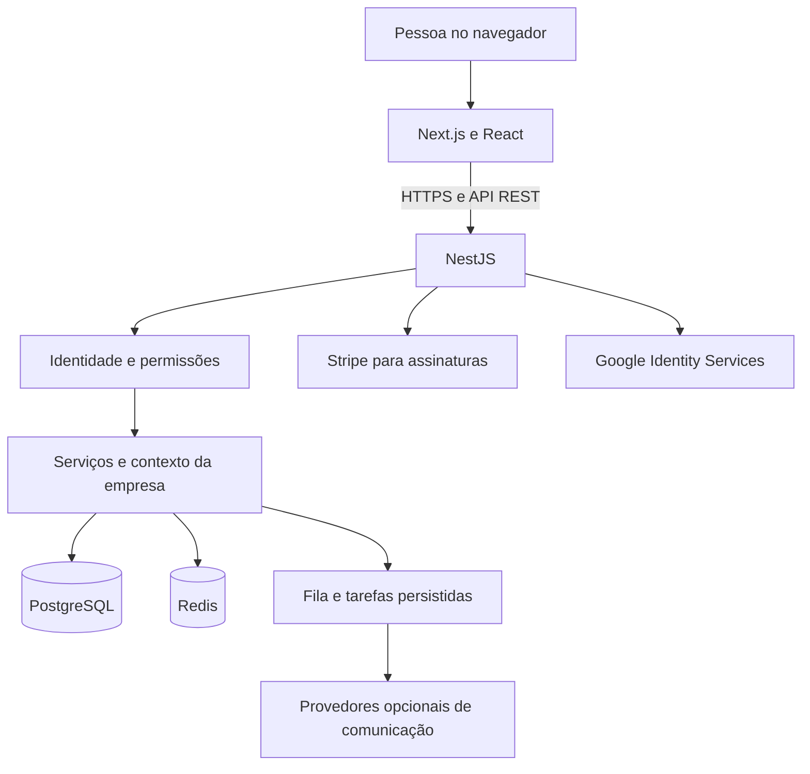

# Arquitetura e tecnologias

## Visão geral

O navegador exibe a aplicação Next.js e envia requisições HTTP à API NestJS. A API valida identidade, permissão e empresa, aplica as regras do negócio e acessa PostgreSQL e Redis. As empresas compartilham a aplicação, enquanto cada operação de negócio utiliza o contexto da empresa autenticada.



Em produção, o frontend foi configurado na Vercel, a API no Railway e o PostgreSQL no Supabase. Redis atende dados temporários e coordenação; ele não substitui o banco relacional. Saúde e revisão publicada precisam ser verificadas em cada deploy.

## Como entender a stack

Uma **linguagem** expressa as instruções do programa. Uma **biblioteca** oferece funções reutilizáveis. Um **framework** organiza a aplicação e estabelece um modo de construir suas partes. O **runtime** executa o programa; o banco armazena seus registros.

| Tecnologia                          | Papel no Nexly e explicação                                                                                                             |
| ----------------------------------- | --------------------------------------------------------------------------------------------------------------------------------------- |
| HTML                                | Estrutura os elementos das páginas, como títulos, campos e botões.                                                                      |
| CSS                                 | Define apresentação, espaçamento, cores e adaptação a telas menores.                                                                    |
| JavaScript                          | Executa interações no navegador e código do ecossistema Node.js.                                                                        |
| TypeScript                          | Acrescenta tipos ao JavaScript e identifica incompatibilidades durante o desenvolvimento. Não substitui validação dos dados recebidos.  |
| React 19                            | Divide a interface em componentes e atualiza a tela conforme o estado muda.                                                             |
| Next.js 16                          | Organiza páginas, rotas, componentes de servidor e cliente, imagens e compilação do frontend.                                           |
| Node.js 24                          | Executa JavaScript no servidor e as ferramentas de desenvolvimento. A versão de referência está em `.nvmrc`.                            |
| NestJS 12                           | Organiza a API em módulos, controllers, serviços e dependências injetadas.                                                              |
| Express                             | Atende as requisições HTTP sob o adaptador utilizado pelo NestJS.                                                                       |
| Tailwind CSS 3                      | Oferece classes utilitárias para construir o visual sem repetir regras de estilo.                                                       |
| Prisma 5                            | Define modelos, gera o cliente de acesso e mantém migrações do PostgreSQL.                                                              |
| PostgreSQL 16                       | Persiste empresas, agenda, produtos, vendas e demais registros relacionados, com transações e índices.                                  |
| Supabase                            | Hospeda o PostgreSQL de produção. As permissões da Data API exigem configuração própria; o login do Nexly é implementado na API NestJS. |
| Redis 7                             | Mantém cache, cotas distribuídas e estados temporários de autenticação.                                                                 |
| Axios                               | Centraliza chamadas HTTP do frontend à API e tratamento de respostas.                                                                   |
| React Hook Form e Zod               | Organizam formulários e validam estrutura e conteúdo das entradas.                                                                      |
| Class Validator e Class Transformer | Validam DTOs e transformam dados na fronteira da API.                                                                                   |
| Recharts                            | Desenha gráficos; valores também podem ser apresentados em texto.                                                                       |
| Framer Motion                       | Implementa transições e animações da interface.                                                                                         |
| Font Awesome e Inter                | Fornecem ícones e tipografia utilizados na identidade visual.                                                                           |
| Sonner                              | Apresenta avisos e confirmações de operações na interface.                                                                              |
| Date Fns e Date Fns TZ              | Manipulam datas, períodos e fusos; distinguem dia civil de instante UTC.                                                                |
| ZXing                               | Apoia leitura de códigos de barras por câmera em fluxos compatíveis.                                                                    |
| MDX e YAML                          | Organizam conteúdo e metadados dos artigos do blog.                                                                                     |
| Argon2id                            | Transforma senhas em hashes verificáveis, sem persistir a senha original.                                                               |
| JWT RS256 e criptografia Node.js    | Assinam tokens e protegem conteúdos que precisam ser recuperados, como estados cifrados de sessão.                                      |
| Otplib e QRCode                     | Apoiam autenticação TOTP e configuração do autenticador.                                                                                |
| Google Auth Library                 | Verifica assinatura e declarações dos tokens recebidos do Google.                                                                       |
| Stripe SDK                          | Cria Checkout e Portal de assinatura e verifica eventos do provedor.                                                                    |
| EventEmitter                        | Conecta eventos e regras entre áreas, como conclusão de atendimento e consumo de insumos.                                               |
| Node Cron                           | Agenda rotinas do backend; trabalhos duráveis mantêm estado no banco.                                                                   |
| Helmet e Compression                | Aplicam cabeçalhos HTTP de proteção e compressão de respostas.                                                                          |
| npm workspaces e Turborepo          | Organizam pacotes e executam tarefas do monorepo.                                                                                       |
| Jest e Playwright                   | Verificam regras da API e jornadas do usuário em navegador.                                                                             |
| ESLint e Prettier                   | Conferem padrões de código e formatação.                                                                                                |
| Docker Compose                      | Disponibiliza ambientes reproduzíveis de serviços e dependências.                                                                       |
| GitHub Actions                      | Executa verificações, builds, varreduras e rotinas de backup configuradas.                                                              |

As versões exatas e transitivas ficam em `package-lock.json`. As versões principais acima descrevem esta revisão; atualizar uma biblioteca requer compatibilidade e testes.

## Organização do código

```text
apps/api/       API NestJS, Prisma e testes unitários
apps/web/       Interface Next.js e conteúdo público
packages/shared/  DTOs, tipos, permissões, presets e limites comuns
packages/tsconfig/  Configurações TypeScript compartilhadas
services/nexusauth/  Serviço complementar, com configuração própria
e2e/            Testes Playwright e fixtures
scripts/        Ferramentas mantidas de operação e verificação
docs/           Documentação pública revisada
```

NexusAuth não faz parte dos workspaces `apps/*` e `packages/*`. A API possui uma ponte opcional por configuração. Sua presença no repositório não significa que todos os recursos do NexusAuth estejam ativos no Nexly.

## Caminho de uma operação

Um controller recebe a requisição e seus parâmetros. Guards verificam autenticação e permissão. O contexto da empresa acompanha a execução. O serviço aplica regras e utiliza Prisma para consultar ou alterar dados. Interceptors tratam aspectos transversais, como auditoria e invalidação de cache. O frontend recebe o resultado e apresenta sucesso, erro ou ação de recuperação.

Regras que precisam ocorrer juntas utilizam transações. Filtros por empresa, políticas do banco, vínculos entre registros e verificações de concorrência se complementam. É necessário validar o papel efetivo usado pela conexão: proprietário da tabela ou credencial com bypass pode alterar o comportamento de RLS.

## Persistência e processamento

O PostgreSQL mantém os dados de negócio e o estado dos trabalhos persistidos. Redis fornece rapidez para informações temporárias e limites compartilhados entre instâncias. Reiniciar a API não deve ser tratado como confirmação de que um trabalho externo foi concluído; estado, idempotência e retorno do provedor determinam seu resultado.

O dashboard reaproveita cache de indicadores. A consulta de pendências é separada para respeitar permissões e atualização recente. Índices, paginação e limites evitam carregar todas as linhas em telas de listagem. O [modelo de dados](MODELO_DADOS.md) e a [referência de rotas](REFERENCIA_API.md) registram os elementos desta versão.

## Arquitetura de assinaturas

O módulo assinaturas separa controller, regras do serviço, catálogo e gateway Stripe. Checkout e Portal usam o vínculo persistido da empresa. A reconciliação consulta o estado atual do provedor em transação e registra o evento processado. Somente no ambiente live ela altera o plano comercial da empresa. Veja [Pagamentos](PAGAMENTOS.md).
